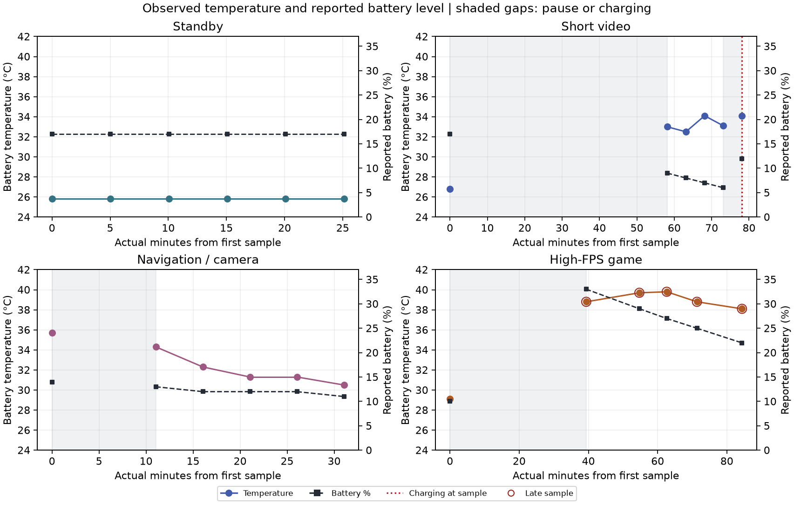

# 课题02 · 个人手机多工况发热与掉电实测

**批次 PC-20261123-002 · 实测数据与交付分析。** 2026-11-23，手机 OnePlus PLU110 / Android 16 / PowerTrace 1.5.1。四个工况各有 6 条原始记录，共 24 条。短视频出现明确充电点，导航/拍摄有暂停，游戏标签下采样严重迟到、存在补电迹象，不能当作严格可比的四个连续 30 分钟实验。原数据与时间戳不改写。

## 提交用中文表

- [24 条时序记录](submission/课题02_24条时序记录.csv)：计划、真实采样时间、电量、温度、功率窗口及记录说明。
- [四工况汇总](submission/课题02_四工况汇总.csv)：有效窗口时间、功率、能量、温度及样本异常计数。
- [高功耗硬件模块与系统省电策略](报告.md)：根据整机观测讨论模块机理，不把可能原因写成分模块实测瓦数。

两张 CSV 为 UTF-8 BOM，可用 Excel 打开。缺失功率保留空白。英文原始导出保留未改。

## 要求与交付对应

[ICEC 第一阶段课题02原文](https://icec.openkub.com/assessment.html#fieldTestSection)要求待机、短视频、导航/拍摄和高帧率游戏四工况，在 30 分钟内每 5 分钟记录电量和发热，提交 24 条时序 CSV，并分析高功耗模块、提出系统省电策略。阶段一另要求校内实地原始记录与本人现场同框照片。本项目不是官网另列的「项目一：智能终端极致省电」，未把它的 24 小时要求套用到这批数据。

| 内容 | 材料 / 状态 |
|---|---|
| 24 条原始时序 | [合并批次表](raw_data/campaign_PC-20261123-002.csv) · [四个工况单表及原始日志](raw_data/) · [原始文件校验](SHA256SUMS-raw.txt)。条数与工况齐全；按真实时间审计，不把计划点当实测。 |
| 电量与温度 | [实测时间折线](results/temperature_and_battery.png) · [时间和异常逐点标注](results/sample_timing.csv)。已有电池温度和系统读数，没有外壳分区温度、环境温度及热成像，不能声称测出了机身热分布。 |
| 功耗、模块分析及省电策略 | [有效功率窗与均值图](results/power_windows.png) · [逐窗电荷计复算](results/observed_power_windows.csv) · [工况核对表](results/condition_audit.csv) · [分析报告](报告.md)。 |
| 实测证据 | [App 结果长图](evidence/app-results.jpg)可说明手机导出界面，不是现场同框照；此次未提供现场同框照，也无法由日志确认校园点位。 |

## 复现

在本目录，Python 3.11+ 安装 Matplotlib 3.8+ 后执行：

~~~sh
python -m pip install 'matplotlib>=3.8'
python analyze_campaign.py
python format_submission.py
~~~

[分析脚本](analyze_campaign.py)核对原始哈希、会话与合并表、ISO/UTC 时钟和观测窗口，并写入独立的结果目录，不修改原始数据。截图中的详情以导出字段和实际时间为准。
