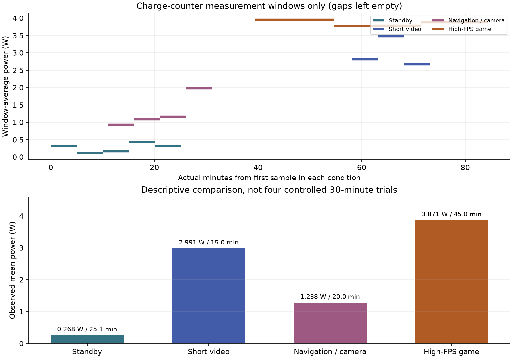

# 手机多工况发热与掉电实测 · PC-20261123-002

## 摘要

本报告采用现有 24 条实际记录作为课题 02 的分析数据，并分别保留原始记录和可用的放电功率窗口。采样时间和工况状态有差异，因此按各自窗口做描述性比较，不假定四组都是等时、无中断的受控对照。按电荷计重新计算后，待机、短视频、导航/拍摄、游戏标签下有效区间均值分别为 **0.268、2.991、1.288、3.871 W**。这里的对象是有效区间内整机电池侧功率，不是即时读数、分模块瓦数或全天功耗。

## 1. 数据与计算口径

- 交付版包含[24 条中文时序记录](submission/课题02_24条时序记录.csv)与[四工况中文汇总](submission/课题02_四工况汇总.csv)。取 [批次原始表](raw_data/campaign_PC-20261123-002.csv) 和 4 个单工况文件；24 行逐字段核对通过，本地 ISO 与 UTC 逐行一致，表头、工况标签和 App 元数据保留原样。时钟为北京时间（UTC+08:00）；以下均用实际时间，不用计划列倒推。
- 电荷计单位 μAh，取区间首末电荷差 ΔQ 和端点电压均值 V（mV），按 E(Wh) = ΔQ×V / 10⁹，P(W) = E / 区间小时数计算。汇总功率是非重叠有效窗总能量 / 总时长。窗口跨暂停、充电或缺乏端点时不计算，也不补零。16 个有效窗，8 条没有功率值。未使用不可靠的瞬时电流字段；能量计该批未返回数据。
- 六行的计划定位为 0、5、10、15、20、25 分钟；不是六行都在这些真实时刻发生。宏观工况时长以日志、时间戳和累计暂停为证据；有效窗通常短于真实运行区间，不能外推到 30 分钟。

## 2. 结果

| 工况标签 | 首末实测跨度 | 有效功率窗口累计 | 窗口加权功率 | 有效区间能量 | 首末电池温度 / 有效窗口净温差 |
|---|---:|---:|---:|---:|---|
| 待机 | 25 分 06.9 秒 | 25.11 min（5 段） | 0.268 W | 0.112 Wh | 25.8→25.8°C / 0.0°C |
| 短视频 | 78 分 06.8 秒 | 15.00 min（3 段） | 2.991 W | 0.748 Wh | 26.8→34.1°C / +0.1°C |
| 导航/拍摄 | 31 分 02.9 秒 | 20.00 min（4 段） | 1.288 W | 0.429 Wh | 35.7→30.5°C / −3.8°C |
| 游戏标签 | 84 分 22.2 秒 | 45.00 min（4 段） | 3.871 W | 2.904 Wh | 29.1→38.1°C / −0.7°C |

- **待机：**五个实际采样间隔约 301–302 秒；首点亮屏，后五点采样时熄屏。因此 0.268 W 含第一段，不能称严格全程熄屏；只取两个端点都熄屏的窗口，总计约 20.10 分钟、0.256 W，也只能确认端点状态。电量停在 17% 不等于零耗电。
- **短视频：**暂停合计约 53 分钟；仅第 2→5 点进入计能，电量 9%→6%。第 6 点明确标记充电，电量回到 12%。有效窗内网络从 Wi-Fi 到蜂窝，无法单独归因给播放或网络。全程首末温差 +7.3°C 跨长间隔，不能当纯播放温升。
- **导航/拍摄：**中途暂停约 6 分钟，开场已 35.7°C；第 2→6 点窗口电量 13%→11%、电池温度下降。降温不表示导航或相机不产生热量，只表明这一段散热与发热的净结果；缺少实际运行应用的独立记录。
- **游戏标签：**暂停约 29 分钟并有采集任务取消日志。第 1→2 点 SOC 10%→33%、电荷计上升，提示间隙可能补过电，但未记录准确时点；该区间未计功率。第 2–6 点迟到 307、928、1103、1327、1807 秒，第 3–6 点功率仍可按真实窗口算，覆盖第 2→6 点。最高电池温度 39.8°C、系统 thermal 最大 2；这不是外壳温度，也不等于已确认发生 GPU 降频。后五点前台包记录是 PowerTrace、FPS 为空，首点 FPS 也只对应采集应用，**不能以此证明游戏或相应画质全程运行**。

## 3. 高功耗硬件模块分析

**观测排序：**游戏标签窗口（3.871 W）＞短视频（2.991 W）＞导航／拍摄（1.288 W）＞待机（0.268 W）。它反映本批有效窗口的整机电池侧功耗；因起始温度、剩余电量、网络和实际负载不完全一致，不能把相邻工况的功率差直接分给某个硬件模块。电池温度受发热、热容、环境和散热同时影响，不是芯片功率读数。

| 工况 | 记录支持的现象 | 可能的高功耗模块与机理 |
|---|---|---|
| 待机 | 电量表显示 17% 不变，但电荷计有放电；后五点记录为熄屏，五段平均 0.268 W。 | 屏幕熄灭后仍有整机基础开销：SoC 的后台唤醒、内存保持、无线连接维持。此批未量化各项占比。 |
| 短视频 | 有效段 2.991 W，屏幕亮；第 2 点 Wi-Fi，后续有效点记录为蜂窝。 | 屏幕持续显示，视频解码器和内存搬运持续工作；流媒体下载会使用 Wi-Fi 或蜂窝基带。信号条件、清晰度和刷新档位都会改变整机功耗，此批不能把其中一项认定为主因。 |
| 导航／拍摄 | 有效段 1.288 W，起始温度偏高，后续降温；导出不能确认导航与拍摄的具体占空比。 | 导航涉及 GNSS、屏幕、地图渲染及数据请求；拍摄涉及相机传感器、ISP、编码和存储。因两种负载未分别记录，不作单模块顺序判断。 |
| 游戏标签 | 本批最高窗口均值 3.871 W，电池最高 39.8°C，系统热状态最高为 2；工况汇总 CPU 平均频率读数约 2604 MHz，待机约 1693 MHz。 | 若实际运行高帧率游戏，CPU 驱动逻辑、GPU 渲染和高刷新屏幕通常是优先排查项。频率是快照，不能推出 CPU 瓦数；GPU 计数和真实游戏 FPS 未记录，现场工况也未独立确认，所以不把 3.871 W 写成 GPU 功耗或已确认的游戏功耗。 |

## 4. 系统省电策略（按使用场景）

| 优先项 | 可以直接做的设置 | 为什么值得做／适用条件 |
|---|---|---|
| 先控屏幕 | 将亮度调到够用，日常用自适应刷新或 60 Hz；待机熄屏，非必要时关闭 AOD。 | 降低持续显示开销；省电比较时固定亮度，避免同一轮同时改两个参数。 |
| 游戏先限帧 | 先维持画质不变、将高帧模式限到 60 fps；若还发热，再单独降渲染分辨率或画质。 | 降低每秒渲染任务和显示刷新负载；游戏内帧率读数用于确认，不能使用采集 App 的 FPS。 |
| 视频优先稳网 | 在同一清晰度下使用信号稳定的 Wi-Fi；反复播放时先下载，且不需要高画质时调低清晰度。 | 减少持续传输和重试；固定同一内容测试，避免把网络变化误认为解码节电。 |
| 地图与相机按需开 | 先下载离线地图，不用时结束导航；录像按画质需求选档，日常场景可优先用较低分辨率或帧率。 | 减少网络请求及相机、编码的持续负载；在需要导航时不要关闭必要的定位。 |
| 管理后台唤醒 | 限制非必要应用自启动与后台同步；保留必要通知和正在运行的采集服务权限。 | 减少空闲时 SoC 被唤醒和无线常驻活动，不用牺牲本实验的数据连续性换节电。 |

若要验证某项实际节电量，做一次**单变量 A/B 对照**：例如同一游戏场景、相近电量与温度、同亮度同网络，分别只改变帧率；使用相同的有效观察时长，将两次电池侧平均功率作差，节电率用（基准功率 − 优化功率）÷ 基准功率。本批没有做这些对照，不报告未测得的节电百分比。

## 5. 读表提示

计划 0/5/10/15/20/25 分钟是采样槽位，实际时间见中文时序表。功率缺项留空；充电、暂停与迟到样本没有删掉，功率只对应可复算的放电窗口。数据测的是电池及系统传感器温度，未测机身各部位温度。
