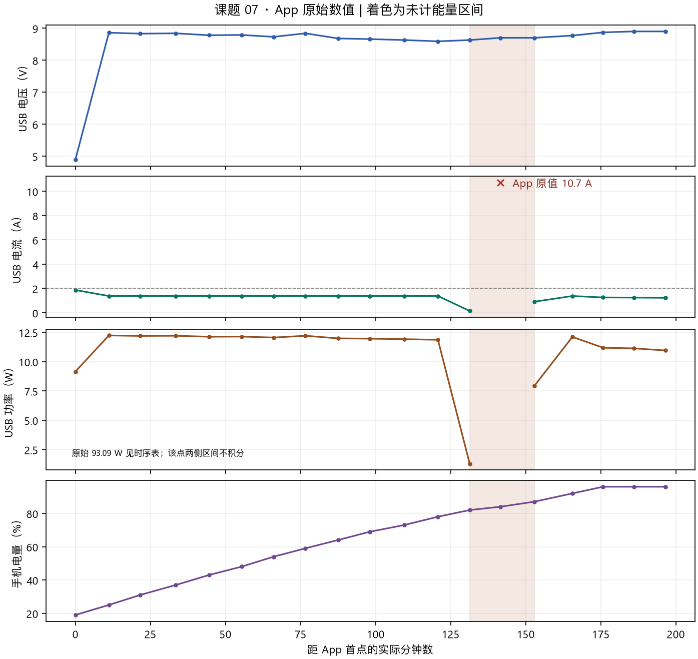

# 课题 07 · 充电宝标称容量与转换效率核验

**会话 CA-20261123_144032 · 以 App 原始记录为准。** 本版替代此前以照片累计读数为主的分析口径。电压、电流、手机电量及时间均来自 App 导出；[接线照片](evidence/USB测量接线.jpg)仅说明布置，仪表快照不替换任何 App 点位。原始文件一字未改。

## 1. 实验与数据

[课题原文](https://icec.openkub.com/assessment.html#fieldTestSection)要求记录铭牌 Wh、每约 10 分钟采集充电宝从满电到耗尽给手机补电的过程，提交原始表并讨论效率与损耗。实物为华为 **CP11QC**，[铭牌](evidence/CP11QC-nameplate.jpg)电芯额定能量 **34.49 Wh**；额定输出 **6200 mAh（5 V / 2 A）**，折合 **31.00 Wh**。31.00 ÷ 34.49 ≈ **89.88%** 是铭牌参考比，非本轮实测效率。多数 App 电压记录约 8.6–8.9 V，工况不同于铭牌的 5 V / 2 A，不直接做容量达标判断。

USB 表型号按 App 记录为 V20，接法为充电宝输出 → USB 表 → 手机。App 共 **19 点**，2026-11-23 14:41:15.932 至 17:57:44.677（北京时间），历时 **196.48 分钟**；相邻点间隔 **10.24–12.70 分钟**。手机电量 **19% → 96%**。电量百分比是手机读数，不代表充电宝剩余电量。CSV 的仪表累计 Wh 为空，不能用累计 Wh 直接求差。

- [原始 App CSV](raw_data/chargeaudit_CA-20261123_144032.csv) · [会话元数据](raw_data/manifest.json) · [App 原汇总](raw_data/summary.json)
- [排版后的 19 点中文 CSV](results/App实测时序_19点.csv) · [区间积分核对表](results/App放电区间复算.csv) · [机器可读摘要](results/复算摘要.json)

## 2. 计算与结论

逐点功率 P=V×I；对相邻两点使用实际秒差，以 E=(P₁+P₂)/2 × Δt(s)/3600 估算区间能量。**第 14 点（原 CSV 索引 13）保留 8.70 V、10.7 A、约 93.09 W 原值。** 由于 10.7 A 明显高于铭牌最大 2 A，分析将其标为异常，不用照片或相邻点推算替代值；第 13→14 和第 14→15 点两个区间均不积分，共 **21.51 分钟**。0.15 A 未超出量程，按原记录保留。

| 项目 | 结果 | 可用性 |
|---|---:|---|
| App 原汇总，未排异常 | 50.675 Wh | 归档留证，含超限读数，不作为能量结论 |
| **16 段保留区间的 USB 输出能量估计** | **33.135 Wh** | 覆盖 **174.97 分钟**；仅为保留区间的梯形估计，不跨空档，不是满到耗尽的总能量 |
| 保留区间时间加权平均功率 | 11.36 W | 分母仅用 174.97 分钟 |
| 整程输出／铭牌比 | 未确认 | 无耗尽末段，不能拿部分区间数值计算整程效率 |
| USB 往返效率 | 无法计算 | 缺独立输入侧原始表、完整输出区间 |

末点 App 仍记录 **8.90 V、1.23 A、手机 96%、充电标记为 1**；元数据已记录满电起点，但结束原因为空，未确认耗尽。**不能把最后一点当断电，也不能事后补 0。** 约 10 分钟一次的电流快照未覆盖全部波动，33.135 Wh 也不是直接测得的连续累计读数。原汇总中的手机净储能和效率字段不引用为本实验结论：它们并非与这 16 段同步闭合的能量收支。

## 3. 升压和其他损耗去向

充电宝将电芯直流变换到 USB 电压，开关管、电感、线路和电芯内阻会产生损耗，主要以热释放，控制与指示电路也有自耗。保护截止、电芯剩余能量与实际条件会影响可输出能量，不都属于升压损耗。USB 表之后还有线缆、接口与手机充电管理损耗；手机系统运行用电也不会全部储存在电池里。不能用一个 USB 表将差额分摊给各模块，也没有测量各项损耗百分比。

## 4. 剩余材料与复现

- **先找同一轮耗尽后的记录**：截止时间、当时手机仍有充电需求的状态、最终仪表读数或熄屏缺读说明。已有可靠记录时优先补交；没有则保留本次阶段性结果。如要计算整程输出比，仍需记录完整截止及末段能量。
- **独立输入侧表**：充电器 → USB 表 → 充电宝输入口，记录从确认耗尽到充满的 USB 输入；有完整输入和完整输出才能算往返效率。[输入侧空表](输入侧记录空表.csv)不含虚构读数。
- **本人校园现场同框照**：现有接线照不能代替；若已拍可直接补交。

[复算脚本](analyze_app.py)只读取本目录的原始 App 导出；在本目录用 Python 3.11+ 和 Matplotlib 运行 `python analyze_app.py`。原始文件可用 [SHA-256 清单](SHA256SUMS-raw.txt)核对。仓库仅收录去除元数据的接线照与铭牌裁图作为旁证；仪表照片读数不参与本报告的能量计算。
