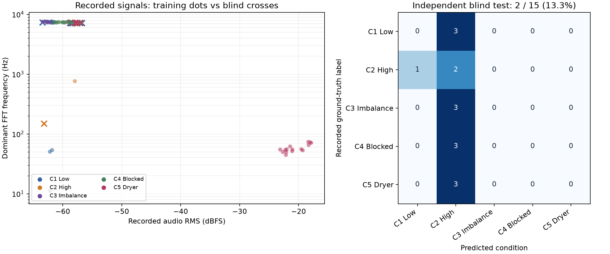

# 项目三 · 日常旋转机械/电器异常声振诊断仪

实测会话 **VD-20261122-002**。训练端使用 MATLAB R2026a + NVIDIA GeForce RTX 5070 Ti（CUDA）拟合 RBF 核岭五分类器；手机端 VibroDiag 1.5.0 使用冻结参数离线推理。盲测不参与拟合。

## 按评分项查看

| [官网项目三评分项](https://icec.openkub.com/assessment.html) | 本目录材料 |
|---|---|
| 原始 WAV/CSV 及实验照 | [训练和盲测原始数据](raw_data/)；五类各 15 组训练，共 75 组，另有 15 组独立盲测。每组含 WAV、加速度 CSV、特征及元数据。[原始文件校验清单](SHA256SUMS-raw.txt)；[风扇实验实拍照（2 张）](photos/)。 |
| 时域/频域特征提取代码 | [RMS、频域和其他特征实现](features.py)、[特征表生成](prepare_features.py)、[MATLAB CUDA 训练](train_vibro_cuda.m)、[固定参数推理](predict_vibro_cuda.m)。[模型权重](results/vibro_cuda_model.mat)、[运行配置](results/run_metadata.json)、[Android 推理实现和一致性参考](android-reference/) 可供复核。 |
| 盲测准确率视频与抗噪报告 | [独立盲测复核报告](盲测复核/盲测复核报告.md)、[逐组预测](盲测复核/predictions_verified.csv)、[抗噪报告](抗噪报告.md)。**盲测视频未提供，报告和结果表不能代替视频。** |

## 风扇实验实拍

- [现场全景](photos/fan-test-overview.jpg)：展示操作人员、手机、桌面和小风扇。
- [风扇与挡板近景](photos/fan-blocking-setup.jpg)：展示风道遮挡实验的装置布置。

两张照片由实验者补充，仅作为现场与装置证据，不用于给原始采样逐组对时，也不能替代盲测视频。公开副本去除 EXIF 等元数据，原图未改。

## 如何理解结果

- **正式独立盲测：2 / 15（13.33%）**。15 条保留原顺序和原真值。手机预测与 MATLAB 用同一份特征复跑 15/15 一致；从 WAV、加速度 CSV 独立重算特征后仍一致。这个结果有效，但不支持模型已经能稳定区分五种工况。
- **MATLAB 同一采集批次 5 折按组验证：70 / 75（93.33%）**。是另一种评估，不能替代独立盲测。手机的原始评估 JSON 还含 **kNN** 结果，不能与 MATLAB 盲测或抗噪混算。
- **来源**：保留的 75 组训练、15 组盲测及相应元数据从手机最终导出原样取出；未将一次中断的录音计入 15 条。没有合成或补造真值、替换错误组、或用本轮盲测重训。抗噪部分另行对测试录音叠加受控白噪，明确标注。

## 下载数据与复现

WAV 使用 Git LFS；若网页只显示指针，运行以下命令下载实际音频。其他文件为普通 Git 文件，校验清单对应下载后的真实文件。

~~~sh
git clone https://github.com/ADR114514/phone-lab.git
cd phone-lab
git lfs install
git lfs pull --include="02-20Days-Challenge/03-vibrodiag/raw_data/**"
cd 02-20Days-Challenge/03-vibrodiag
~~~

Python 3.12+ 安装 NumPy / Matplotlib。使用 MATLAB R2026a + Parallel Computing Toolbox 和支持的 NVIDIA/CUDA 环境。以下第一条从训练目录重算特征；如需重训请在独立副本上执行，避免覆盖提交的固定模型。

~~~sh
python prepare_features.py --source raw_data
~~~

盲测复跑使用已冻结模型。将单独备份的**旧训练导出目录**传给第二个位置参数，可以比对 300 个训练文件是否保持不变；如果只下载了本仓库，仓库的原始文件清单也能核对公开副本的完整性。

~~~sh
python audit_blind_trials.py raw_data /path/to/original-training-export 盲测复核
matlab -batch "verify_blind_cuda(fullfile(pwd,char([30450 27979 22797 26680])))"
python plot_blind_audit.py
~~~
