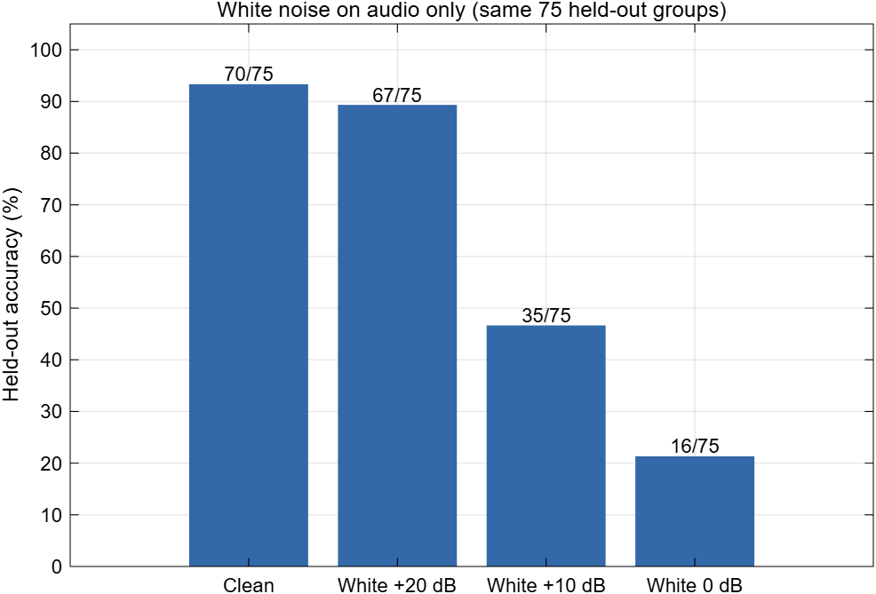

# 项目三 · 抗噪报告

## 方法

以真实 75 组 WAV 和加速度输入作同会话五折评估。每折各工况留出连续编号的 3 组（15 组），只用其余 60 组干净数据拟合，预处理统计量也只在训练折计算。对同一留出组分别以原始录音及三档定量白噪输入评估，振动信号不变。以固定随机种子加噪并重提声学特征；实际 SNR 及削波检查见[数据溯源](inputs/data_provenance.json)。以下结果均由 MATLAB CUDA 拟合的 RBF 核岭模型生成。

| 录音条件 | 正确／试次 | 准确率 |
|---|---:|---:|
| 原始录音（未额外加噪） | 70/75 | 93.33% |
| +20 dB SNR 白噪 | 67/75 | 89.33% |
| +10 dB SNR 白噪 | 35/75 | 46.67% |
| 0 dB SNR 白噪 | 16/75 | 21.33% |

数据：[汇总表](results/cv_summary.csv) · [逐组预测](results/cv_predictions.csv) · [干净录音混淆矩阵](results/cv_confusion_clean.csv)。

## 结论和局限

+20 dB 白噪下正确数少 3 组；到 +10 dB 准确率明显下降，0 dB 接近五类均匀随机的 20% 参考水平。结果只覆盖对白噪的此种加法，并不证明 FFT 特征对真实人声、混响或设备改变普遍稳健。每种工况均在同一次采集期内完成，不能外推到其他手机或环境。**另外录制的独立盲测为 2/15（13.33%）**，15 条手机和 MATLAB 预测一致；该结果不属于本表，也不得用本表较高的分数替代。见[独立盲测复核](盲测复核/盲测复核报告.md)。
