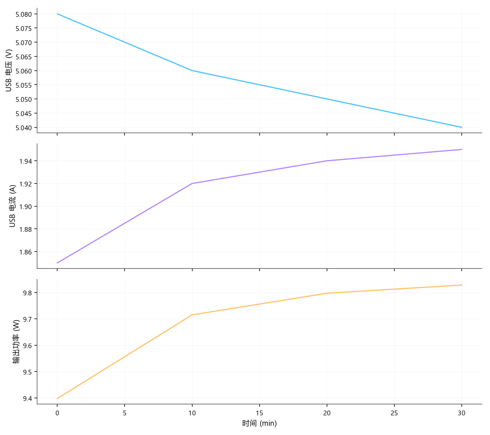
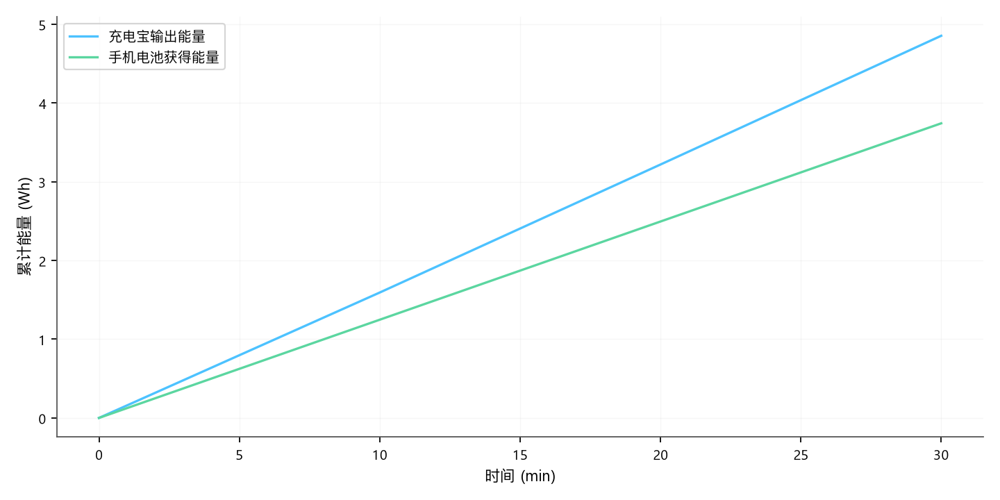
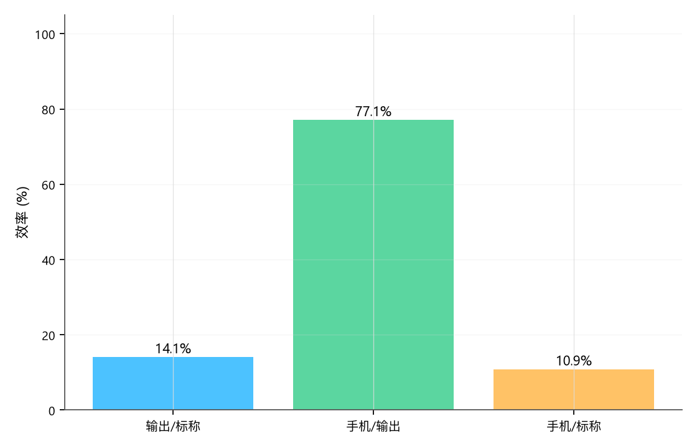
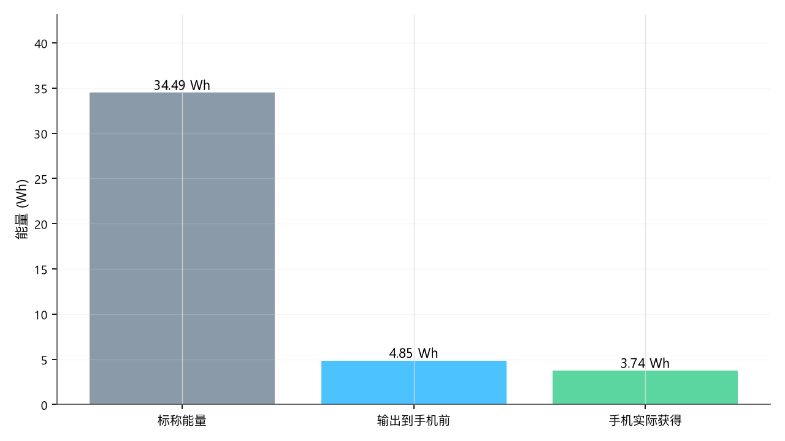

# 充电宝容量与转换效率核验报告

- 输入数据：charge_discharge_template.csv
- 充电宝：Huawei CP11QC
- 标称能量：34.49 Wh
- 标称输出容量：6200 mAh @ 5.0 V

## 1. 实测结果

| 指标 | 数值 |
|---|---|
| 采样点数 / 时长 | 4 点 / 0.50 h |
| 平均输出功率 | 9.68 W |
| 峰值输出功率 | 9.83 W |
| 充电宝输出能量 E_out | 4.854 Wh |
| 手机电池获得能量 E_phone | 3.742 Wh（口径：battery_pct_x_capacity）|
| 输出能量 / 标称能量 | 14.1% |
| 手机获得 / 输出能量 | 77.1% |
| 手机获得 / 标称能量 | 10.9% |
| 等效输出容量 @5.0 V | 971 mAh（标称 6200 mAh）|

## 2. 损耗分解（相对标称能量）

| 环节 | 能量损失 (Wh) | 占比 |
|---|---|---|
| 电芯 → 输出（升压/转换） | 29.636 | 85.9% |
| 输出 → 手机电池（线损+充电损耗） | 1.112 | 3.2% |
| 合计 | 30.748 | 89.1% |

铭牌反推的升压效率：89.9%（6200 mAh × 5.0 V / 34.49 Wh）。

## 3. 图

## 4. 结论与讨论（写作提示）

1. 实测输出能量与标称能量的差异，主要来自升压转换（3.7 V 电芯 → 5 V/9 V）和线缆/接口损耗；
2. 手机电池获得能量小于输出能量，差额为线损 + 手机内部充电管理损耗（发热）；
3. 检查曲线是否在末段出现电压跌落/电流下降（电量耗尽前的保护行为）；
4. 至少重复 2 次，报告均值与极差，并写明起始电量、环境温度、测试仪型号与精度。
