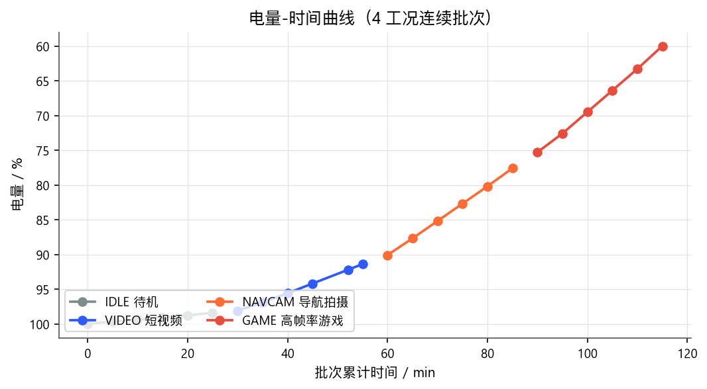
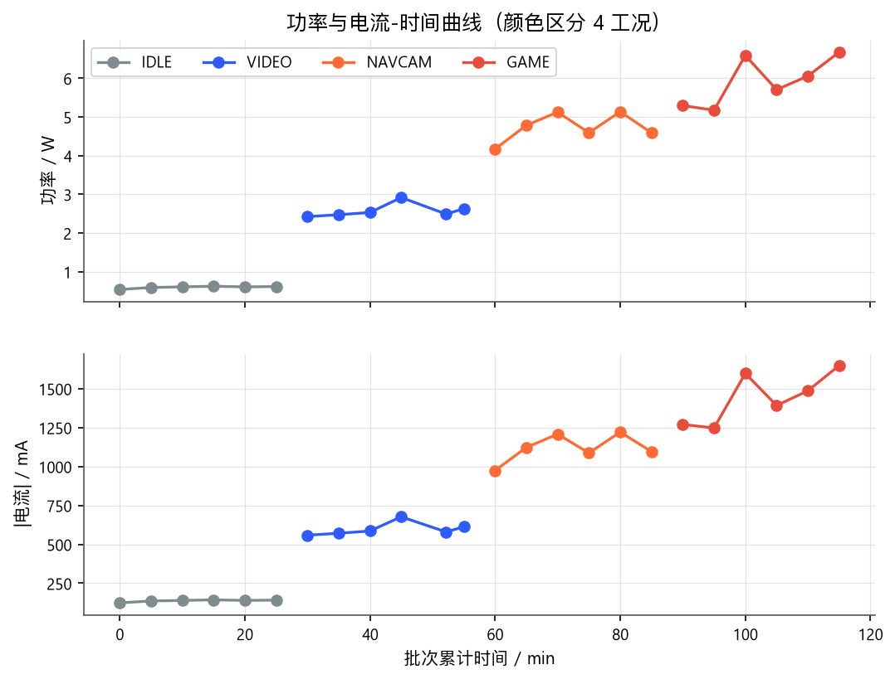
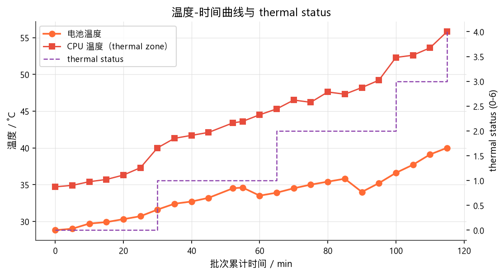
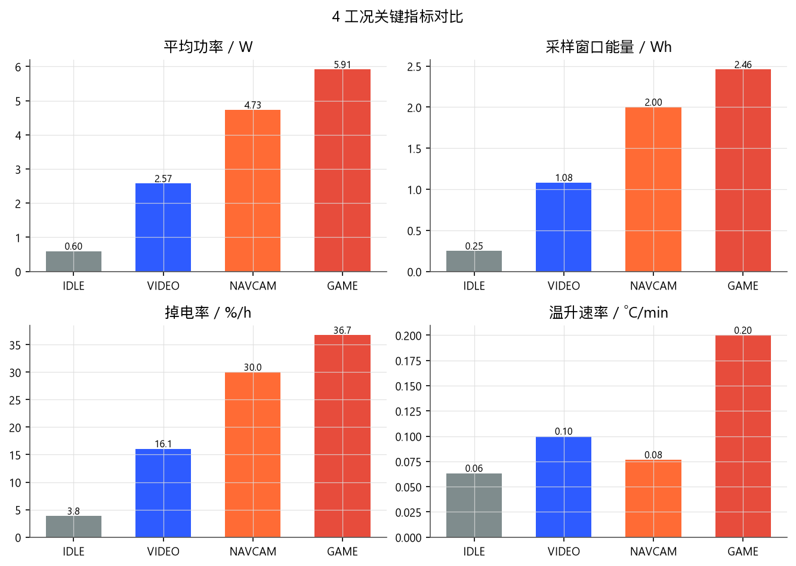
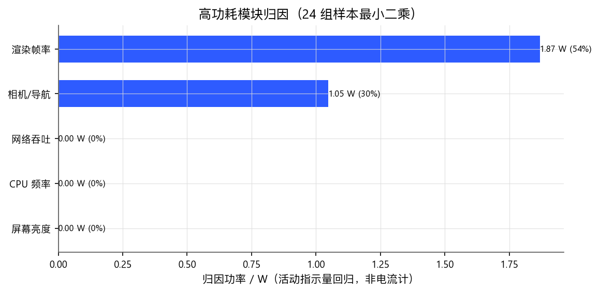
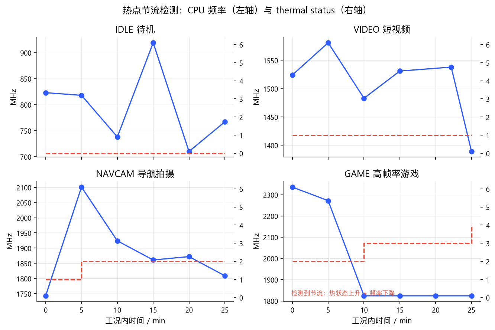

# 课题02 · 个人手机多工况发热与掉电实测 —— 分析报告

> 由 analysis/power/analyze.py 自动生成；数值口径与局限见第 6 节。
>
> **本报告使用的是 data/demo 合成演示数据（SYNTHETIC），仅用于验证分析管线，不能作为课程报告的真实测量结论。** 换成 data/raw 下的真机数据后重跑即可。

## 摘要

本批数据共 24 个采样点（4 工况 × 6 点），已通过 24 行完整性校验。四个工况的平均功率分别为：待机 0.60 W、短视频 2.57 W、导航拍摄 4.73 W、高帧率游戏 5.91 W；对应掉电率 3.8 / 16.1 / 30.0 / 36.7 %/h，电池温度分别上升 1.9 / 3.0 / 2.3 / 6.0 °C。活动指示量回归 R² = 0.956、RMSE = 0.435 W；归因最大的活动模块为 渲染帧率。热节流检测结果：GAME。

**样本目录**：E:/phone function/phone-lab/data/demo/power/20261118_PC-20261118-001；**批次**：PC-20261118-001；**设备**：Pixel 7。

## 1. 数据完整性与采样质量

| 工况 | 行数 | 缺失采样点 | 迟到样本 | 充电行 | 电量回升 | 功率重算误差 | CPU 温度缺失 | fps 缺失 |
| --- | --- | --- | --- | --- | --- | --- | --- | --- |
| IDLE | 6 | 无 | 0 | 0 | 0 | 0.0008 | 0 | 6 |
| VIDEO | 6 | 无 | 1 | 0 | 0 | 0.0002 | 0 | 0 |
| NAVCAM | 6 | 无 | 0 | 0 | 0 | 0.0001 | 0 | 6 |
| GAME | 6 | 无 | 0 | 0 | 0 | 0.0001 | 0 | 0 |

校验结论：

- ⚠️ VIDEO: 1 个迟到样本（间隔 > 390 s，序号 [5]）
- 以上问题不阻断分析，但已在口径中标记；迟到样本按实际时间戳参与积分。
- 电流符号约定：本批导出放电为负值，分析统一取绝对值。

## 2. 4 工况关键指标

| 工况 | 平均功率 W | 峰值 W | 能量 Wh（积分） | 掉电 % | 掉电率 %/h | 温升 °C | 温升速率 °C/min | thermal 峰值 | thermal 上升次数 |
| --- | --- | --- | --- | --- | --- | --- | --- | --- | --- |
| IDLE | 0.596 | 0.622 | 0.250 | 1.6 | 3.8 | 1.9 | 0.063 | 0 | 0 |
| VIDEO | 2.574 | 2.915 | 1.082 | 6.7 | 16.1 | 3.0 | 0.100 | 1 | 0 |
| NAVCAM | 4.729 | 5.132 | 2.000 | 12.5 | 30.0 | 2.3 | 0.077 | 2 | 1 |
| GAME | 5.913 | 6.673 | 2.458 | 15.3 | 36.7 | 6.0 | 0.200 | 4 | 2 |

能量交叉校验（采样窗梯形积分 vs 均值×时长 vs charge_counter 差分 vs App 汇总）：

| 工况 | 积分 Wh | 均值×时长 Wh | charge_counter 差分 Wh | App 汇总 Wh |
| --- | --- | --- | --- | --- |
| IDLE | 0.250 | 0.298 | 0.294 | — |
| VIDEO | 1.082 | 1.287 | 1.261 | — |
| NAVCAM | 2.000 | 2.365 | 2.288 | — |
| GAME | 2.458 | 2.956 | 2.730 | — |

图表：

*电量-时间曲线*

*功率/电流-时间曲线*

*温度-时间曲线*

*4 工况指标对比*

## 3. 高功耗模块归因

> **声明：这是“活动指示量回归”，不是硬件电流计。** SoC/PMIC 不为每个子系统提供独立电流采样，只能把整机功率对可观测的活动指示量做最小二乘拟合，得到“在该活动水平下平均功率增加多少”的估计；共线项之间无法唯一分解，非负约束下被剔除的项按 0 计入。

| 模块 | 活动指示量 | 系数 | 单位 | 归因功率 W | 占总功耗 % | 占活动功耗 % |
| --- | --- | --- | --- | --- | --- | --- |
| 基线（待机/系统固定开销） | 1 | 0.5364 | W | 0.536 | 15.5 | — |
| 屏幕亮度 | screen_brightness_pct / 100 | 0.0000 | W / 100% 亮度 | 0.000 | 0.0 | 0.0 |
| CPU 频率 | cpu_freq_mhz_avg / 1000 | 0.0000 | W / GHz | 0.000 | 0.0 | 0.0 |
| 网络吞吐 | (net_rx + net_tx) / 1000 | 0.0000 | W / Mbps | 0.000 | 0.0 | 0.0 |
| 渲染帧率 | fps / 60 | 4.4340 | W / 60fps | 1.868 | 54.1 | 64.1 |
| 相机/导航 | condition_id == NAVCAM | 4.1927 | W（NAVCAM 期间） | 1.048 | 30.4 | 35.9 |

- 非负约束剔除项：CPU 频率、网络吞吐、屏幕亮度（与其它项共线或系数为负）。
- 拟合质量：R² = 0.956，RMSE = 0.435 W，平均实测 3.453 W，模型预测合计 3.453 W。

*高功耗模块归因*

### 3.2 工况增量分解（测量值，不依赖回归）

在“每个工况一种活动组合”的实验设计下，回归项之间必然共线；因此再用工况顺序的功率增量做一次交叉验证：待机基线 + 各工况新增活动类别的增量 = 高负载工况功率。

| 来源 | 工况区间 | 增量功率 W | 占批次平均功耗 % | 累计 W | 说明 |
| --- | --- | --- | --- | --- | --- |
| 待机基线（屏幕熄灭） | IDLE | 0.596 | 17.3 | 0.596 | 系统常驻 + 内存 + 网络待机，屏幕与相机均关闭 |
| 屏幕 + 视频解码 + 网络下行 | IDLE -> VIDEO | 1.978 | 57.3 | 2.574 | 固定亮度 50% 连续播放短视频 |
| 相机 + GNSS + 视频编码 + 网络上/下行 | VIDEO -> NAVCAM | 2.155 | 62.4 | 4.729 | 导航 + 1080p 录像同时工作 |
| GPU/CPU 高帧率渲染 | NAVCAM -> GAME | 1.184 | 34.3 | 5.913 | 90/120fps 高画质游戏，后段伴随热节流 |

- 增量累计 5.913 W，与最高工况平均功率 5.913 W 一致。

## 4. 热点与节流

| 工况 | thermal 起始 | thermal 峰值 | 频率前半/后半 MHz | 频率降幅 % | 是否节流 | 补充 |
| --- | --- | --- | --- | --- | --- | --- |
| IDLE | 0 | 0 | 793 / 799 | -0.7 | 否 | — |
| VIDEO | 1 | 1 | 1529 / 1486 | 2.8 | 否 | — |
| NAVCAM | 1 | 2 | 1923 / 1847 | 3.9 | 否 | raw 首次 thermal 上升于 150 s，频率 1886 -> 1896 MHz |
| GAME | 2 | 4 | 2144 / 1824 | 14.9 | 是 | raw 首次 thermal 上升于 450 s，频率 2093 -> 1836 MHz |

判定规则：thermal_status 在工况内上升（Δ≥1 或出现上升事件）**且** CPU 平均频率后半段较前半段下降 ≥5% 时标记为热节流。

*热节流检测*

## 5. 省电策略建议（基于本批测量）

- 屏幕亮度：本批数据中亮度项未进入有效模型（亮度可能被固定在同一档），建议补充不同亮度档位的对照实验后再定量。
- 刷新率/帧率：帧率每降低 15 fps（0.25 个 60fps 单位）约省 **1.108 W**；高帧率游戏实测平均 5.91 W，60fps + 中画质可显著降低功耗。
- 待机基线：固定开销约 **0.54 W**（系统常驻 + 屏幕/内存/网络待机）；待机工况实测 0.60 W、3.8 %/h，建议关闭 AOD/常驻通知、限制后台联网与高刷待机。
- 温控：GAME 工况出现热节流（GAME 频率 2144->1824 MHz）；建议避免边充边玩、加散热背夹或降低画质，并把高负载工况安排在环境温度较低的时段。
- 后台与传感器：导航 + 相机同时工作时功耗最高，建议按需授权定位精度（高精度 -> 省电模式）、录像结束立即释放相机；网络侧优先 WiFi、关闭 VPN/代理。
- 实测增量：短视频相对待机增加 1.98 W（屏幕 + 解码 + 下行），是日常使用中最容易通过降亮度/降分辨率压缩的一段。
- 实测增量：导航拍摄在短视频基础上再增加 2.15 W（相机 + GNSS + 编码 + 上行），建议 1080p/30fps 录制、关闭后台导航播报。
- 实测增量：高帧率游戏在导航拍摄基础上再增加 1.18 W（GPU/CPU 渲染），是最主要的发热与掉电来源，优先降帧率与画质。
- 整体：本批 24 个采样点平均功耗 **3.45 W**，最高工况 GAME 平均 5.91 W；若目标是半天续航，可优先在游戏/导航拍摄两类高功耗场景做降档。

## 6. 口径与局限

1. **采样口径**：每 5 min 一个点、每工况 6 点（0–25 min）；能量按采样时间轴梯形积分，并与“均值×30 min”及 charge_counter_uah 差分交叉校验，差异见第 2 节表格。
2. **功率换算**：power_w = voltage_mv × |current_now_ua| / 1e9；CURRENT_NOW 符号厂商相关，分析取绝对值。
3. **能量计数**：charge_counter_uah 在不支持 CURRENT_NOW 时作为主口径；两者一致性用于发现异常点。
4. **归因局限**：共线性（CPU 频率与帧率、网络与屏幕）无法唯一分解；指示量回归只能解释相关关系，不构成因果；缺少相机/定位硬件计数器，NAVCAM 项是工况指示量而非真实相机电流。
5. **温度**：电池温度与 thermal zone 温度来自不同传感器，受握持方式、环境温度、机壳材质影响；温升速率依赖起始温度，跨批次比较应控制起始温度与降温时间。
6. **样本量**：4 工况 × 6 点 = 24 点规模较小，不足以做显著性检验；建议重复 3 个批次并做批间方差分析。

## 7. 复现方式

~~~powershell
python analysis/power/analyze.py --data data/raw/power/<session> --out analysis/out/power
~~~

输出结构：figures/（6 张图）、tables/（质量表、指标表、能量交叉校验、模块归因、拟合残差、热节流）、本报告。
