# phone-lab 课程设计总报告（草稿）

> 自动生成时间：2026-11-18 01:12；由 analysis/report/build_report.py 合并 analysis/out/{power,wifi,vibro}/*_report.md。
>
> **数据来源声明：本稿中的分析结果基于 data/demo 合成演示数据（SYNTHETIC），用于证明分析管线与报告结构可用，不是真机实测结果。提交课程报告前必须替换为 data/raw 下的真实实验数据并重新运行三条管线。**

## 目录

1. [课题02 · 个人手机多工况发热与掉电实测](#课题02)
2. [课题03 · 教学楼/宿舍无线信号盲区测绘](#课题03)
3. [项目三 · 手机声振诊断仪](#项目三)
4. [跨课题综合小结（待填写）](#综合小结)
5. [复现步骤](#复现步骤)

---

## 关键结果速览

### 课题02 功耗与发热

| 工况 | 平均功率 W | 掉电 % | 掉电率 %/h | 温升 °C | thermal 峰值 |
| --- | --- | --- | --- | --- | --- |
| IDLE | 0.596 | 1.6 | 3.8 | 1.9 | 0 |
| VIDEO | 2.574 | 6.7 | 16.1 | 3.0 | 1 |
| NAVCAM | 4.729 | 12.5 | 30.0 | 2.3 | 2 |
| GAME | 5.913 | 15.3 | 36.7 | 6.0 | 4 |

### 课题03 无线盲区测绘

- 点位分级：强 1、中 2、弱 3、盲区 2；最差点位：P01、P08。
- 材质等效附加衰减：无墙体 0.0 dB、玻璃 5.0 dB、混凝土 18.5 dB、混合 14.5 dB、金属 24.7 dB。
- 路径损耗指数 n = 1.97。

### 项目三 声振诊断

- 训练样本 15 组、特征 32 维；LOOCV 准确率 86.7%。
- 盲测 15 组，准确率 93.3%。
- 抗噪（白噪声）：SNR 20 dB → 100.0%、SNR 10 dB → 46.7%、SNR 5 dB → 20.0%、SNR 0 dB → 20.0%、SNR -5 dB → 20.0%

---

# 第一部分：课题02 · 个人手机多工况发热与掉电实测

## 课题02 · 个人手机多工况发热与掉电实测 —— 分析报告

> 由 analysis/power/analyze.py 自动生成；数值口径与局限见第 6 节。
>
> **本报告使用的是 data/demo 合成演示数据（SYNTHETIC），仅用于验证分析管线，不能作为课程报告的真实测量结论。** 换成 data/raw 下的真机数据后重跑即可。

### 摘要

本批数据共 24 个采样点（4 工况 × 6 点），已通过 24 行完整性校验。四个工况的平均功率分别为：待机 0.60 W、短视频 2.57 W、导航拍摄 4.73 W、高帧率游戏 5.91 W；对应掉电率 3.8 / 16.1 / 30.0 / 36.7 %/h，电池温度分别上升 1.9 / 3.0 / 2.3 / 6.0 °C。活动指示量回归 R² = 0.956、RMSE = 0.435 W；归因最大的活动模块为 渲染帧率。热节流检测结果：GAME。

**样本目录**：E:/phone function/phone-lab/data/demo/power/20261118_PC-20261118-001；**批次**：PC-20261118-001；**设备**：Pixel 7。

### 1. 数据完整性与采样质量

| 工况 | 行数 | 缺失采样点 | 迟到样本 | 充电行 | 电量回升 | 功率重算误差 | CPU 温度缺失 | fps 缺失 |
| --- | --- | --- | --- | --- | --- | --- | --- | --- |
| IDLE | 6 | 无 | 0 | 0 | 0 | 0.0008 | 0 | 6 |
| VIDEO | 6 | 无 | 1 | 0 | 0 | 0.0002 | 0 | 0 |
| NAVCAM | 6 | 无 | 0 | 0 | 0 | 0.0001 | 0 | 6 |
| GAME | 6 | 无 | 0 | 0 | 0 | 0.0001 | 0 | 0 |

校验结论：

- ⚠️ VIDEO: 1 个迟到样本（间隔 > 390 s，序号 [5]）
- 以上问题不阻断分析，但已在口径中标记；迟到样本按实际时间戳参与积分。
- 电流符号约定：本批导出放电为负值，分析统一取绝对值。

### 2. 4 工况关键指标

| 工况 | 平均功率 W | 峰值 W | 能量 Wh（积分） | 掉电 % | 掉电率 %/h | 温升 °C | 温升速率 °C/min | thermal 峰值 | thermal 上升次数 |
| --- | --- | --- | --- | --- | --- | --- | --- | --- | --- |
| IDLE | 0.596 | 0.622 | 0.250 | 1.6 | 3.8 | 1.9 | 0.063 | 0 | 0 |
| VIDEO | 2.574 | 2.915 | 1.082 | 6.7 | 16.1 | 3.0 | 0.100 | 1 | 0 |
| NAVCAM | 4.729 | 5.132 | 2.000 | 12.5 | 30.0 | 2.3 | 0.077 | 2 | 1 |
| GAME | 5.913 | 6.673 | 2.458 | 15.3 | 36.7 | 6.0 | 0.200 | 4 | 2 |

能量交叉校验（采样窗梯形积分 vs 均值×时长 vs charge_counter 差分 vs App 汇总）：

| 工况 | 积分 Wh | 均值×时长 Wh | charge_counter 差分 Wh | App 汇总 Wh |
| --- | --- | --- | --- | --- |
| IDLE | 0.250 | 0.298 | 0.294 | — |
| VIDEO | 1.082 | 1.287 | 1.261 | — |
| NAVCAM | 2.000 | 2.365 | 2.288 | — |
| GAME | 2.458 | 2.956 | 2.730 | — |

图表：

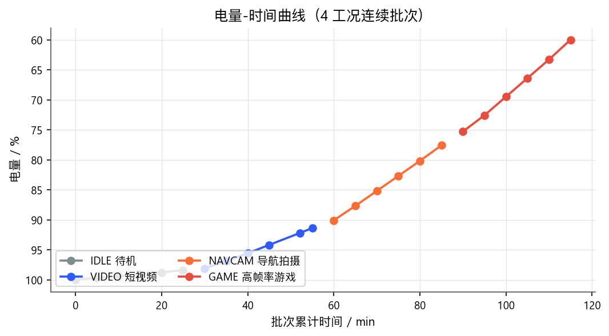

*电量-时间曲线*

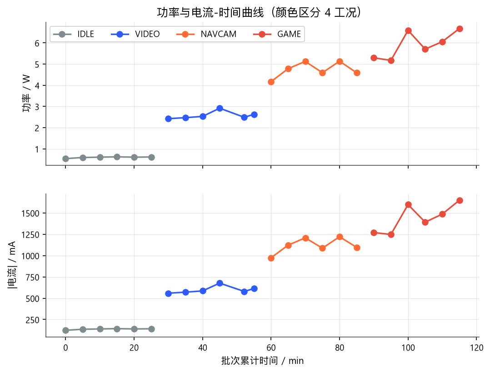

*功率/电流-时间曲线*

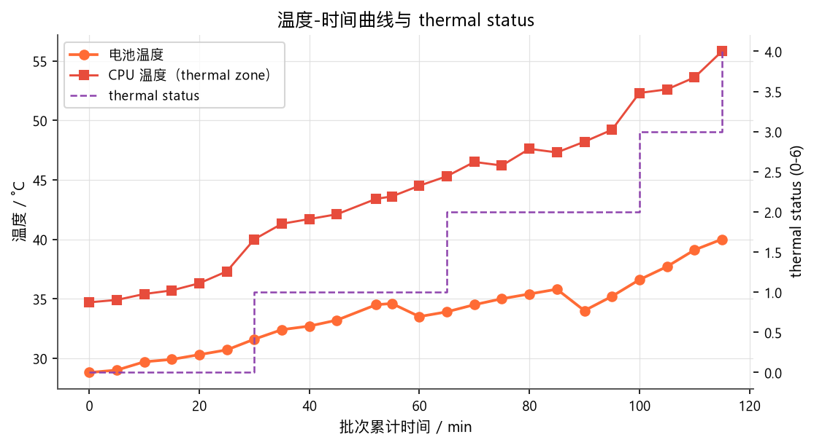

*温度-时间曲线*

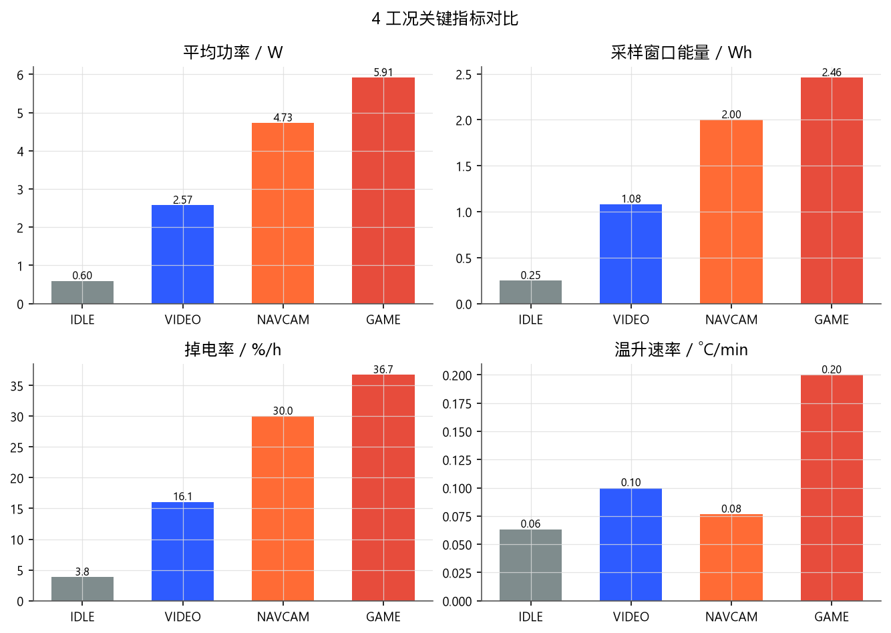

*4 工况指标对比*

### 3. 高功耗模块归因

> **声明：这是“活动指示量回归”，不是硬件电流计。** SoC/PMIC 不为每个子系统提供独立电流采样，只能把整机功率对可观测的活动指示量做最小二乘拟合，得到“在该活动水平下平均功率增加多少”的估计；共线项之间无法唯一分解，非负约束下被剔除的项按 0 计入。

| 模块 | 活动指示量 | 系数 | 单位 | 归因功率 W | 占总功耗 % | 占活动功耗 % |
| --- | --- | --- | --- | --- | --- | --- |
| 基线（待机/系统固定开销） | 1 | 0.5364 | W | 0.536 | 15.5 | — |
| 屏幕亮度 | screen_brightness_pct / 100 | 0.0000 | W / 100% 亮度 | 0.000 | 0.0 | 0.0 |
| CPU 频率 | cpu_freq_mhz_avg / 1000 | 0.0000 | W / GHz | 0.000 | 0.0 | 0.0 |
| 网络吞吐 | (net_rx + net_tx) / 1000 | 0.0000 | W / Mbps | 0.000 | 0.0 | 0.0 |
| 渲染帧率 | fps / 60 | 4.4340 | W / 60fps | 1.868 | 54.1 | 64.1 |
| 相机/导航 | condition_id == NAVCAM | 4.1927 | W（NAVCAM 期间） | 1.048 | 30.4 | 35.9 |

- 非负约束剔除项：CPU 频率、网络吞吐、屏幕亮度（与其它项共线或系数为负）。
- 拟合质量：R² = 0.956，RMSE = 0.435 W，平均实测 3.453 W，模型预测合计 3.453 W。

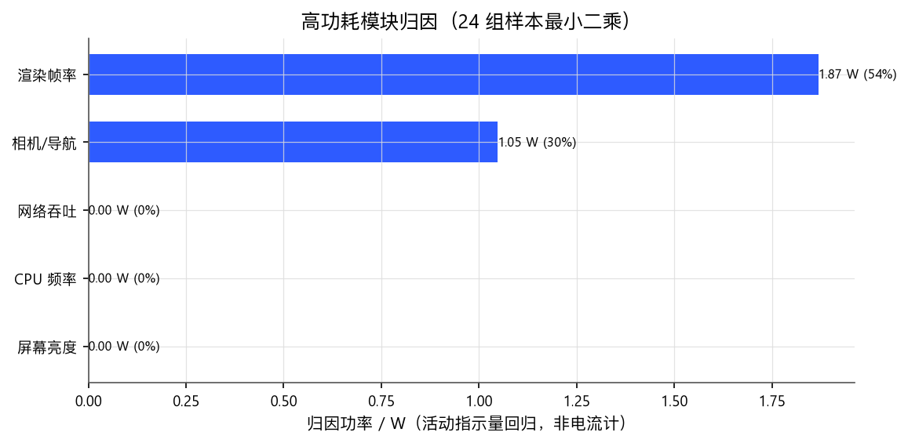

*高功耗模块归因*

#### 3.2 工况增量分解（测量值，不依赖回归）

在“每个工况一种活动组合”的实验设计下，回归项之间必然共线；因此再用工况顺序的功率增量做一次交叉验证：待机基线 + 各工况新增活动类别的增量 = 高负载工况功率。

| 来源 | 工况区间 | 增量功率 W | 占批次平均功耗 % | 累计 W | 说明 |
| --- | --- | --- | --- | --- | --- |
| 待机基线（屏幕熄灭） | IDLE | 0.596 | 17.3 | 0.596 | 系统常驻 + 内存 + 网络待机，屏幕与相机均关闭 |
| 屏幕 + 视频解码 + 网络下行 | IDLE -> VIDEO | 1.978 | 57.3 | 2.574 | 固定亮度 50% 连续播放短视频 |
| 相机 + GNSS + 视频编码 + 网络上/下行 | VIDEO -> NAVCAM | 2.155 | 62.4 | 4.729 | 导航 + 1080p 录像同时工作 |
| GPU/CPU 高帧率渲染 | NAVCAM -> GAME | 1.184 | 34.3 | 5.913 | 90/120fps 高画质游戏，后段伴随热节流 |

- 增量累计 5.913 W，与最高工况平均功率 5.913 W 一致。

### 4. 热点与节流

| 工况 | thermal 起始 | thermal 峰值 | 频率前半/后半 MHz | 频率降幅 % | 是否节流 | 补充 |
| --- | --- | --- | --- | --- | --- | --- |
| IDLE | 0 | 0 | 793 / 799 | -0.7 | 否 | — |
| VIDEO | 1 | 1 | 1529 / 1486 | 2.8 | 否 | — |
| NAVCAM | 1 | 2 | 1923 / 1847 | 3.9 | 否 | raw 首次 thermal 上升于 150 s，频率 1886 -> 1896 MHz |
| GAME | 2 | 4 | 2144 / 1824 | 14.9 | 是 | raw 首次 thermal 上升于 450 s，频率 2093 -> 1836 MHz |

判定规则：thermal_status 在工况内上升（Δ≥1 或出现上升事件）**且** CPU 平均频率后半段较前半段下降 ≥5% 时标记为热节流。

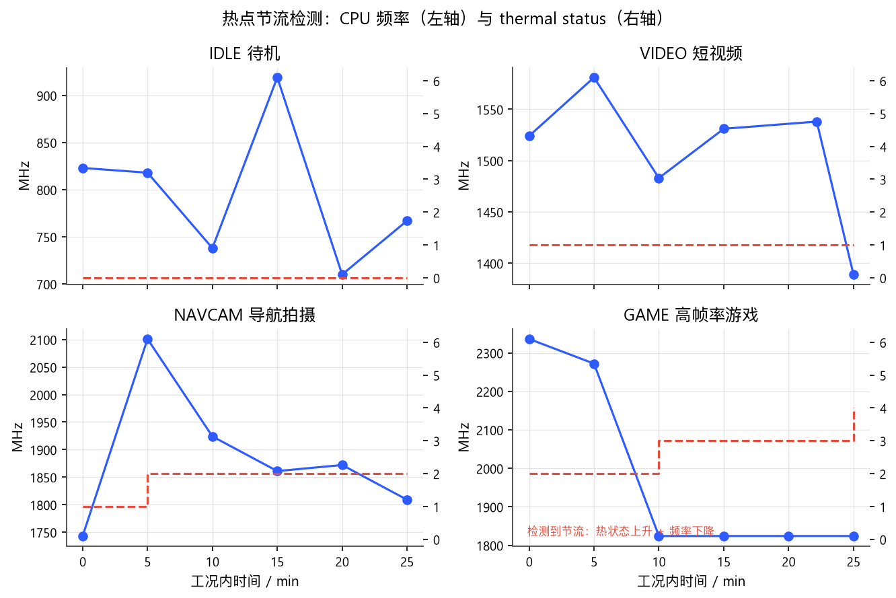

*热节流检测*

### 5. 省电策略建议（基于本批测量）

- 屏幕亮度：本批数据中亮度项未进入有效模型（亮度可能被固定在同一档），建议补充不同亮度档位的对照实验后再定量。
- 刷新率/帧率：帧率每降低 15 fps（0.25 个 60fps 单位）约省 **1.108 W**；高帧率游戏实测平均 5.91 W，60fps + 中画质可显著降低功耗。
- 待机基线：固定开销约 **0.54 W**（系统常驻 + 屏幕/内存/网络待机）；待机工况实测 0.60 W、3.8 %/h，建议关闭 AOD/常驻通知、限制后台联网与高刷待机。
- 温控：GAME 工况出现热节流（GAME 频率 2144->1824 MHz）；建议避免边充边玩、加散热背夹或降低画质，并把高负载工况安排在环境温度较低的时段。
- 后台与传感器：导航 + 相机同时工作时功耗最高，建议按需授权定位精度（高精度 -> 省电模式）、录像结束立即释放相机；网络侧优先 WiFi、关闭 VPN/代理。
- 实测增量：短视频相对待机增加 1.98 W（屏幕 + 解码 + 下行），是日常使用中最容易通过降亮度/降分辨率压缩的一段。
- 实测增量：导航拍摄在短视频基础上再增加 2.15 W（相机 + GNSS + 编码 + 上行），建议 1080p/30fps 录制、关闭后台导航播报。
- 实测增量：高帧率游戏在导航拍摄基础上再增加 1.18 W（GPU/CPU 渲染），是最主要的发热与掉电来源，优先降帧率与画质。
- 整体：本批 24 个采样点平均功耗 **3.45 W**，最高工况 GAME 平均 5.91 W；若目标是半天续航，可优先在游戏/导航拍摄两类高功耗场景做降档。

### 6. 口径与局限

1. **采样口径**：每 5 min 一个点、每工况 6 点（0–25 min）；能量按采样时间轴梯形积分，并与“均值×30 min”及 charge_counter_uah 差分交叉校验，差异见第 2 节表格。
2. **功率换算**：power_w = voltage_mv × |current_now_ua| / 1e9；CURRENT_NOW 符号厂商相关，分析取绝对值。
3. **能量计数**：charge_counter_uah 在不支持 CURRENT_NOW 时作为主口径；两者一致性用于发现异常点。
4. **归因局限**：共线性（CPU 频率与帧率、网络与屏幕）无法唯一分解；指示量回归只能解释相关关系，不构成因果；缺少相机/定位硬件计数器，NAVCAM 项是工况指示量而非真实相机电流。
5. **温度**：电池温度与 thermal zone 温度来自不同传感器，受握持方式、环境温度、机壳材质影响；温升速率依赖起始温度，跨批次比较应控制起始温度与降温时间。
6. **样本量**：4 工况 × 6 点 = 24 点规模较小，不足以做显著性检验；建议重复 3 个批次并做批间方差分析。

### 7. 复现方式

~~~powershell
python analysis/power/analyze.py --data data/raw/power/<session> --out analysis/out/power
~~~

输出结构：figures/（6 张图）、tables/（质量表、指标表、能量交叉校验、模块归因、拟合残差、热节流）、本报告。

# 第二部分：课题03 · 教学楼/宿舍无线信号盲区测绘

## 课题03 · 教学楼/宿舍无线信号盲区测绘 —— 分析报告

> 由 analysis/wifi/analyze.py 自动生成；方法口径与局限见文末。
>
> **本报告使用的是 data/demo 合成演示数据（SYNTHETIC），仅用于验证分析管线，不能作为课程报告的真实测量结论。** 换成 data/raw 下的真机数据后重跑即可。

### 摘要

本次测绘共 8 个点位 × 3 次重复，得到 24 行有效记录。盲区分级：强 1 个、中 2 个、弱 3 个、盲区 2 个。以 P01（5.0 m，-49.0 dBm）为参考，拟合路径损耗指数 n = 1.97；混凝土等效附加衰减 18.5 dB、金属 24.7 dB、玻璃 5.0 dB，与经验值同量级。最差点位见第 5 节分级表与改善建议。

**会话**：WS-20261118-001；**样本目录**：E:/phone function/phone-lab/data/demo/wifi/20261118_WS-20261118-001；**设备**：Pixel 7。

### 1. 点位设计与测量方法

| 点位 | 名称 | 类型 | 墙体材质 | 遮挡描述 | 到 AP 距离 m | 楼层 | 现场照片 |
| --- | --- | --- | --- | --- | --- | --- | --- |
| P01 | 教学楼 2F 走廊中段（基准点） | corridor | 无墙体 | 无墙体遮挡，AP 在走廊上方吊顶内 | 5.0 | — | （占位） |
| P02 | 走廊 90° 转角 | corner | 混凝土 | 两侧承重墙，转角 90°，非视距 | 10.0 | — | （占位） |
| P03 | 电梯口 | elevator | 金属 | 金属电梯门与井道，强反射 | 10.0 | — | （占位） |
| P04 | 楼梯间 | stairwell | 混凝土 | 混凝土楼梯间隔墙 + 上下楼层反射 | 14.0 | — | （占位） |
| P05 | 宿舍门口（金属门） | dorm | 金属 | 金属防盗门关闭，门缝泄漏 | 16.0 | — | （占位） |
| P06 | 教室靠窗（玻璃幕墙） | classroom | 玻璃 | 单层玻璃幕墙 + 窗帘 | 16.0 | — | （占位） |
| P07 | 实验室设备间（机柜） | lab | 混合 | 机柜金属板 + 轻质隔墙混合 | 20.0 | — | （占位） |
| P08 | 室外连廊/操场 | outdoor | 无墙体 | 无墙体，视距但距离远 | 30.0 | — | （占位） |

- 测量口径：每点位 3 次重复、间隔 ≥30 s；每次 20 次 TCP RTT（223.5.5.5:443，超时 1000 ms）、5 次 HTTP GET（TTFB/总耗时）、5 次网关 TCP 建连；App 保持前台、屏幕常亮。
- 同一点位 3 次重复的位置、朝向保持一致（地面标记），同一时段完成 8 个点位以减少网络负载漂移。
- 定位开关必须打开（Android 12+ 读取 RSSI/扫描结果的前提）；扫描受限时记录 note。
- 照片占位：真机实验请按 SOP 拍摄墙体与 AP 方向照片，命名 photos/<pointId>_<stamp>.jpg。

### 2. 数据完整性与质量

| 点位 | 重复次数 | 缺失重复 | scan 明细 | 非法 RSSI 行 | 延迟缺失 | 丢包缺失 |
| --- | --- | --- | --- | --- | --- | --- |
| P01 | 3 | 无 | 3 | 0 | 0 | 0 |
| P02 | 3 | 无 | 3 | 0 | 0 | 0 |
| P03 | 3 | 无 | 3 | 0 | 0 | 0 |
| P04 | 3 | 无 | 3 | 0 | 0 | 0 |
| P05 | 3 | 无 | 3 | 0 | 0 | 0 |
| P06 | 3 | 无 | 3 | 0 | 0 | 0 |
| P07 | 3 | 无 | 3 | 0 | 0 | 0 |
| P08 | 3 | 无 | 3 | 0 | 0 | 0 |

- ✅ 24 行齐全（8 点位 × 3 次），每点位均有 scan 明细，RSSI 均在合理区间。

### 3. 点位测量结果

| 点位 | RSSI 均值 dBm | RSSI 标准差 dB | 延迟均值 ms | 延迟 P95 ms | 抖动 ms | 丢包 % | 稳定性 % |
| --- | --- | --- | --- | --- | --- | --- | --- |
| P01 | -49.0 | 0.00 | 8.3 | 18.5 | 1.4 | 0.00 | 100.0 |
| P02 | -74.3 | 0.58 | 38.2 | 90.1 | 6.4 | 4.03 | 99.2 |
| P03 | -80.0 | 0.00 | 61.4 | 150.6 | 13.3 | 6.47 | 100.0 |
| P04 | -75.3 | 1.53 | 40.6 | 96.4 | 8.0 | 4.47 | 98.0 |
| P05 | -83.3 | 2.08 | 81.0 | 196.2 | 14.5 | 8.03 | 97.5 |
| P06 | -64.0 | 1.00 | 17.4 | 39.5 | 3.2 | 0.00 | 98.4 |
| P07 | -75.3 | 0.58 | 40.5 | 100.5 | 10.4 | 4.00 | 99.2 |
| P08 | -64.3 | 0.58 | 21.2 | 48.9 | 4.3 | 0.00 | 99.1 |

稳定性评分 = 100 × (1 - min(1, RSSI 标准差 / |RSSI 均值|))，用于衡量同一位置重复测量的可复现性。

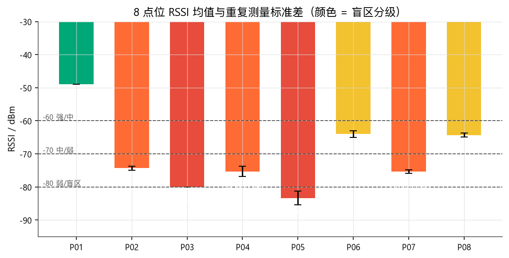

*8 点位 RSSI 均值与标准差*

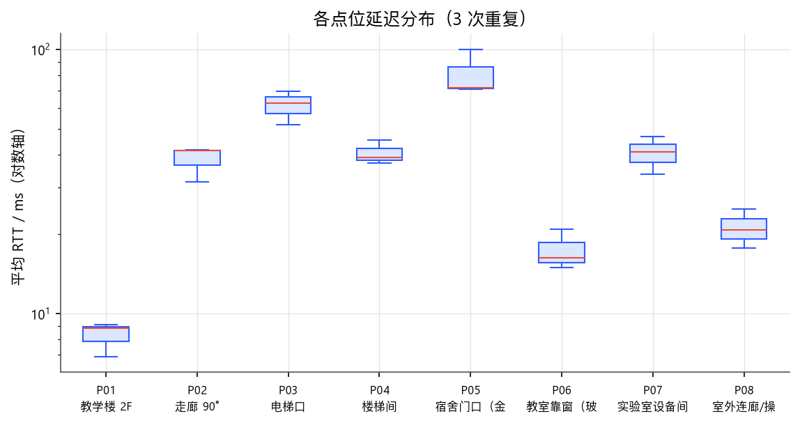

*各点位延迟分布*

### 4. 墙体材质与多径衰减分析

自由空间参考：P01 距离 5.0 m、RSSI -49.0 dBm；路径损耗指数 n = 1.97（无遮挡点位最小二乘拟合（2 点））。无遮挡点位拟合 R² = 1.000；每个点位的等效附加衰减 = 自由空间预测 - 实测。

| 材质 | 点位数 | 点位 | 均值 dB | 中位数 dB | 标准差 dB | 经验参考 dB | 与参考差 dB |
| --- | --- | --- | --- | --- | --- | --- | --- |
| 无墙体 | 2 | P01;P08 | 0.0 | 0.0 | 0.0 | 0 | 0.0 |
| 玻璃 | 1 | P06 | 5.0 | 5.0 | 0.0 | 6 | -1.0 |
| 混凝土 | 2 | P02;P04 | 18.5 | 18.5 | 1.3 | 18 | 0.5 |
| 混合 | 1 | P07 | 14.5 | 14.5 | 0.0 | 14 | 0.5 |
| 金属 | 2 | P03;P05 | 24.7 | 24.7 | 0.5 | 25 | -0.3 |

- 结论框架：混凝土约 -18 dB、金属约 -25 dB、玻璃约 -6 dB、混合材质约 -14 dB；实测均值与经验值的偏差反映墙体厚度、含水率、入射角度与多径叠加，写入报告时应结合实际点位描述解释偏差。

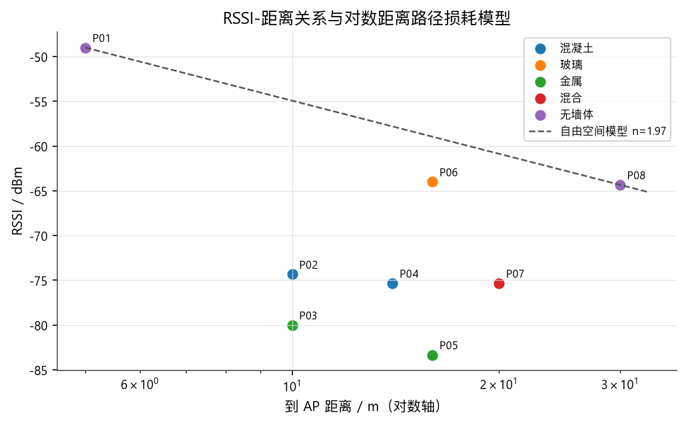

*RSSI-距离关系与路径损耗拟合*

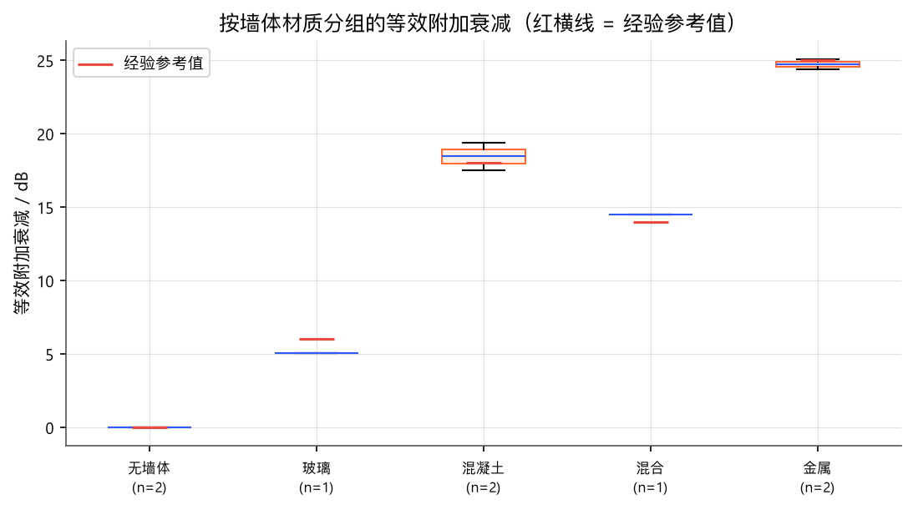

*按材质分组的等效附加衰减*

#### 4.2 多径与相关性

| 指标 A | 指标 B | Pearson r | Spearman rho | 解读 |
| --- | --- | --- | --- | --- |
| RSSI 标准差 | 附加衰减 | 0.35 | 0.18 | 弱正相关（r=0.35） |
| RSSI 标准差 | 延迟抖动 | 0.38 | 0.32 | 弱正相关（r=0.38） |
| RSSI 标准差 | 遮挡复杂度编码 | 0.30 | 0.21 | 弱正相关（r=0.30） |
| 延迟抖动 | 附加衰减 | 0.89 | 0.84 | 强正相关（r=0.89） |
| 延迟 P95 | 附加衰减 | 0.91 | 0.84 | 强正相关（r=0.91） |
| RSSI 均值 | 延迟均值 | -0.90 | -0.99 | 强负相关（r=-0.90） |
| RSSI 均值 | 丢包率 | -0.89 | -0.93 | 强负相关（r=-0.89） |
| 同信道 AP 数 | 延迟均值 | 0.19 | 0.38 | 几乎无正相关（r=0.19） |
| 最强同信道 RSSI | 延迟均值 | -0.91 | -0.98 | 强负相关（r=-0.91） |

多径判读：RSSI 标准差与延迟抖动越大，说明非视距/强反射越明显；金属与转角点位的抖动通常显著高于视距点位，符合多径衰落规律。

### 5. 邻道干扰与盲区分级

| 点位 | 同信道 AP 数均值 | 最多 | 最强同信道 RSSI dBm | 邻信道 AP 数均值 | 延迟均值 ms | 丢包 % |
| --- | --- | --- | --- | --- | --- | --- |
| P01 | 1.3 | 2 | -50.3 | 0.0 | 8.3 | 0.00 |
| P02 | 1.0 | 2 | -73.5 | 0.0 | 38.2 | 4.03 |
| P03 | 2.7 | 5 | -79.7 | 0.0 | 61.4 | 6.47 |
| P04 | 2.7 | 4 | -75.7 | 0.0 | 40.6 | 4.47 |
| P05 | 1.3 | 2 | -86.0 | 0.0 | 81.0 | 8.03 |
| P06 | 2.0 | 3 | -63.0 | 0.0 | 17.4 | 0.00 |
| P07 | 2.3 | 5 | -79.3 | 0.0 | 40.5 | 4.00 |
| P08 | 1.3 | 3 | -66.5 | 0.0 | 21.2 | 0.00 |

| 点位 | 材质 | RSSI dBm | 延迟 P95 ms | 丢包 % | 分级 | 主要问题 | 建议 | 优先级 |
| --- | --- | --- | --- | --- | --- | --- | --- | --- |
| P01 | 无墙体 | -49.0 | 18.5 | 0.00 | 强 | 指标基本可用 | 无需处理；可作为其他点位的参考基准 | P3 |
| P08 | 无墙体 | -64.3 | 48.9 | 0.00 | 中 | 指标基本可用 | 保持观察；若该区域有高码率业务，优先考虑启用 5G 频段 | P2 |
| P06 | 玻璃 | -64.0 | 39.5 | 0.00 | 中 | 指标基本可用 | 保持观察；若该区域有高码率业务，优先考虑启用 5G 频段 | P2 |
| P04 | 混凝土 | -75.3 | 96.4 | 4.47 | 弱 | 延迟 P95 过高（多径/拥塞） | 增加 AP 补点或调整现有 AP 天线方向；该点位优先切 5G | P1 |
| P07 | 混合 | -75.3 | 100.5 | 4.00 | 弱 | 延迟 P95 过高（多径/拥塞） | 增加 AP 补点或调整现有 AP 天线方向；该点位优先切 5G | P1 |
| P02 | 混凝土 | -74.3 | 90.1 | 4.03 | 弱 | 延迟 P95 过高（多径/拥塞） | 增加 AP 补点或调整现有 AP 天线方向；该点位优先切 5G | P1 |
| P05 | 金属 | -83.3 | 196.2 | 8.03 | 盲区 | RSSI 低于 -80 dBm（覆盖不足） | 立即补点（走廊/门口附近新增 AP 或室分天线）并做信道规划 | P0 |
| P03 | 金属 | -80.0 | 150.6 | 6.47 | 盲区 | 丢包率过高（重传/干扰） | 立即补点（走廊/门口附近新增 AP 或室分天线）并做信道规划 | P0 |

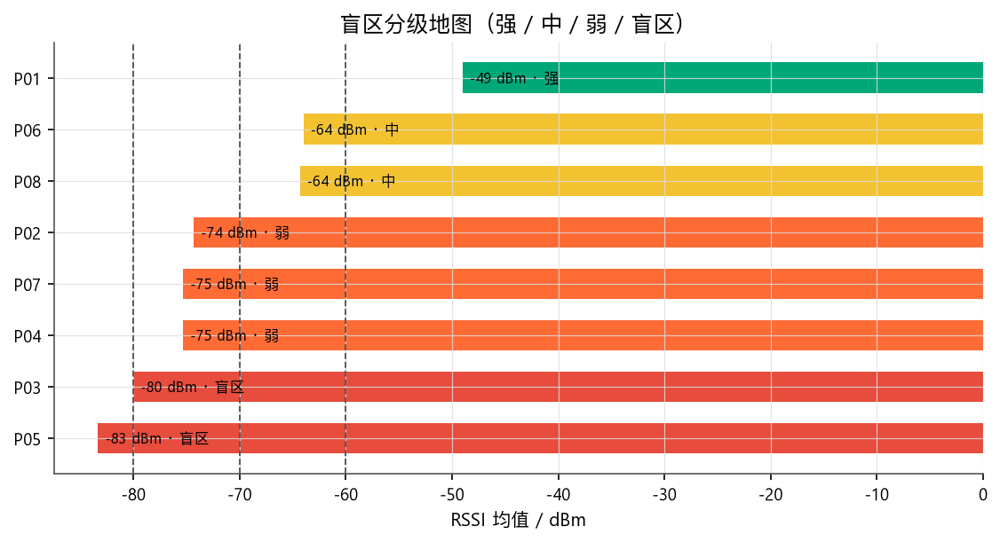

*盲区分级地图*

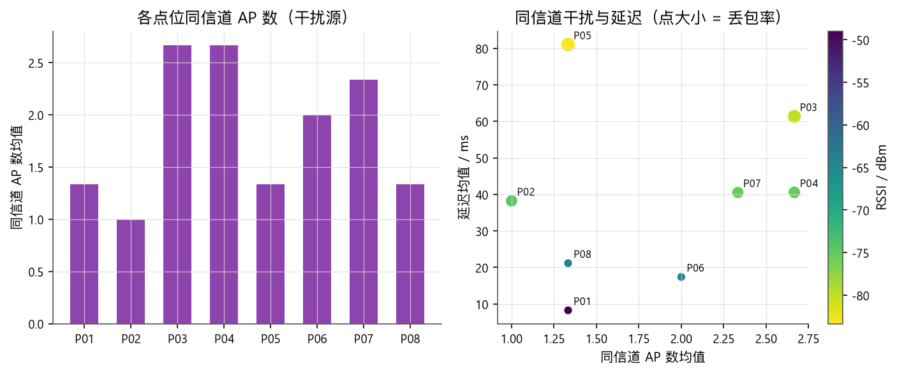

*同信道干扰与延迟*

### 6. 盲区改善建议

- **P04 楼梯间**（混凝土，RSSI -75 dBm，P95 96 ms，丢包 4.5%）：延迟 P95 过高（多径/拥塞）；建议：增加 AP 补点或调整现有 AP 天线方向；该点位优先切 5G。
- **P07 实验室设备间（机柜）**（混合，RSSI -75 dBm，P95 100 ms，丢包 4.0%）：延迟 P95 过高（多径/拥塞）；建议：增加 AP 补点或调整现有 AP 天线方向；该点位优先切 5G。
- **P02 走廊 90° 转角**（混凝土，RSSI -74 dBm，P95 90 ms，丢包 4.0%）：延迟 P95 过高（多径/拥塞）；建议：增加 AP 补点或调整现有 AP 天线方向；该点位优先切 5G。
- **P05 宿舍门口（金属门）**（金属，RSSI -83 dBm，P95 196 ms，丢包 8.0%）：RSSI 低于 -80 dBm（覆盖不足）；建议：立即补点（走廊/门口附近新增 AP 或室分天线）并做信道规划。
- **P03 电梯口**（金属，RSSI -80 dBm，P95 151 ms，丢包 6.5%）：丢包率过高（重传/干扰）；建议：立即补点（走廊/门口附近新增 AP 或室分天线）并做信道规划。
- 混凝土：实测等效附加衰减 18.5 dB（经验参考 18 dB）；穿墙场景应优先把 AP 放到走廊侧。
- 金属：实测 24.7 dB（经验 25 dB）；电梯口/金属门内基本无法穿透，建议用走廊侧 AP + 泄漏电缆/室分覆盖门口区域。
- 玻璃：实测 5.0 dB（经验 6 dB）；玻璃幕墙对 2.4G 损耗小，但窗外反射会带来多径抖动，靠近窗边建议锁 5G 频段。
- 信道规划：各点位同信道 AP 数均值 1.8（最多 5 个），最强同信道 RSSI 均值 -72 dBm；2.4G 应严格使用 1/6/11 三信道并降低发射功率，高密度区域（实验室/宿舍）优先 5G 频段与 80 MHz 以下带宽以减少重叠。
- 路径损耗模型：n = 1.97（无遮挡点位最小二乘拟合（2 点）），自由空间拟合 R² = 1.000
- 补点原则：优先在“转角后/金属门内/楼梯间”等非视距位置补点；新增 AP 与最弱点位距离控制在覆盖半径内，并用 5G 回传减少 2.4G 同频干扰。

### 7. 局限与改进

1. **样本量**：每点 3 次重复只能给出粗粒度标准差；要区分多径波动与测量噪声，建议每点 ≥10 次。
2. **单 AP 关联**：RSSI 只反映关联 AP，不反映邻区整体覆盖；盲区判定应结合扫描明细与 AP 布点图。
3. **距离估计**：distance_m 是估算值（平面图量取），误差直接进入路径损耗模型；若能拿到 AP 精确坐标，应改用射线追踪或实测标定。
4. **n 的标定**：本分析只用无遮挡点位拟合 n。若整栋楼几乎没有视距点位，n 会被墙体损耗污染，应在报告里说明或使用同楼层走廊长度做标定。
5. **干扰指标**：scan 结果受 Android 扫描节流影响可能不完整；同信道 AP 数只能作为干扰代理，不能替代频谱分析仪。
6. **时间漂移**：RSSI 与网络负载随时间变化，8 个点位应尽量在同一时段完成，并记录测试时间。

### 8. 复现方式

~~~powershell
python analysis/wifi/analyze.py --data data/raw/wifi/<session> --out analysis/out/wifi
~~~

# 第三部分：项目三 · 手机声振诊断仪

## 项目三 · 手机声振诊断仪 —— 分析报告

> 由 analysis/vibro/analyze.py 自动生成；特征定义见 docs/feature_spec.md，分类器为 z-score + kNN(k=3)，纯 numpy 实现。
>
> **本报告使用的是 data/demo 合成演示数据（SYNTHETIC），仅用于验证分析管线，不能作为课程报告的真实测量结论。** 换成 data/raw 下的真机数据后重跑即可。

### 摘要

本批数据共 15 组样本（5 工况，每组 3–3 组），提取 32 维声振特征。z-score + kNN(k=3) 的留一法（LOOCV）准确率为 **86.7%**；各工况准确率：C1_NORMAL_LOW 33%、C2_NORMAL_HIGH 100%、C3_IMBALANCE 100%、C4_BLOCKED 100%、C5_HAIRDRYER 100%。
盲测 15 组（不参与训练）的准确率为 **93.3%**，盲测表内预测与脚本重算预测的一致率为 100.0%。
抗噪：SNR 10 dB 时白噪声下准确率 46.7%，0 dB 时白噪声 20.0%、粉红噪声 20.0%；详细曲线见第 5 节。

**会话**：VD-20261118-001；**样本目录**：E:/phone function/phone-lab/data/demo/vibro/20261118_VD-20261118-001；**设备**：Pixel 7。

### 1. 数据与完整性

| 工况 | 已采集组数 | 目标组数 | complete |
| --- | --- | --- | --- |
| C1_NORMAL_LOW | 3 | 3 | 1 |
| C2_NORMAL_HIGH | 3 | 3 | 1 |
| C3_IMBALANCE | 3 | 3 | 1 |
| C4_BLOCKED | 3 | 3 | 1 |
| C5_HAIRDRYER | 3 | 3 | 1 |

| 工况 | 实际样本组数 | 工况标签 |
| --- | --- | --- |
| C1_NORMAL_LOW | 3 | 风扇低档正常 |
| C2_NORMAL_HIGH | 3 | 风扇高档正常 |
| C3_IMBALANCE | 3 | 扇叶轻微失衡 |
| C4_BLOCKED | 3 | 风道遮挡 |
| C5_HAIRDRYER | 3 | 吹风机热风档 |

- 特征交叉校验：脚本按 WAV 重算的特征与 App 写出 features.csv 相比，最大绝对误差 5.000e-07、最大相对误差 4.794e-04（小于 feature_spec 要求的 1e-3 量级）。
- ✅ 5 工况样本齐全，dataset_index 与实际样本一致。

### 2. 特征工程

| 特征组 | 维度 | 代表特征 | 物理意义 |
| --- | --- | --- | --- |
| 音频时域 | 6 | audio_rms_dbfs / crest / zcr / kurtosis | 响度、峰值因数、过零率、冲击性，区分风扇与吹风机 |
| 音频频域 | 7 | audio_centroid_hz / rolloff85 / flatness / harmonic_ratio / hnr_db | 音色亮度、高频滚降、谐波结构；失衡带来边带、遮挡带来高频衰减 |
| 音频频带 | 7 | band_0_100 … band_10k_20k | 能量分布；吹风机高频宽带、遮挡后高频能量下降 |
| 振动时域 | 4 | accel_rms / peak / crest / zcr | 振动强度与冲击性；失衡时 1x 振动明显增大 |
| 振动频域 | 3 | accel_peak_hz / centroid_hz / flatness | 转频与频谱形状 |
| 振动频带 | 5 | accel_band_0_5 … accel_band_50_100 | 低频转频、中高频轴承/气流振动占比 |

完整特征定义见 docs/feature_spec.md；本脚本实现与 App 的 FeatureExtractor 逐条对齐（帧起点/谱归一化/频带分母/谐波 bin/短帧补零等约定），共 32 个数值特征 + 6 个标签列 = 38 列。

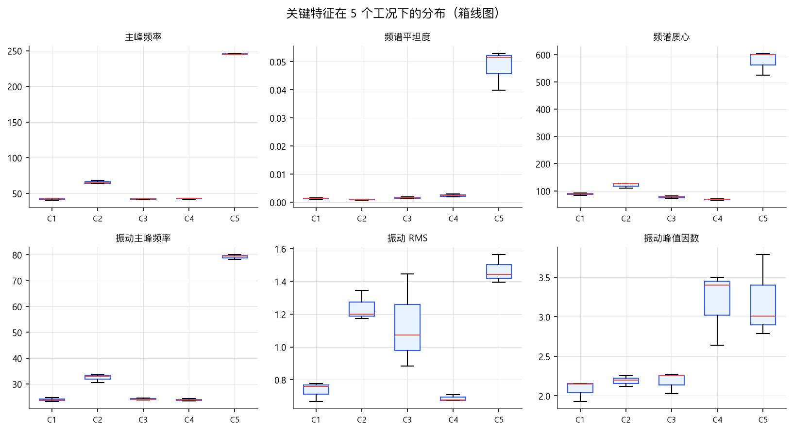

*关键特征在 5 工况下的分布*

### 3. 分类结果（LOOCV）

- LOOCV 准确率：**86.7%**（15 折）。
- 训练集自检（resubstitution，仅参考）：100.0%。
- 标准化与 k：每折重新拟合 z-score（训练折均值/标准差，标准差为 0 时置 1），k = 3，欧氏距离，1/(d+eps) 加权投票，平票取最近邻类别。

混淆矩阵（行=真实，列=预测）：

| 真实\预测 | C1_NORMAL_LOW | C2_NORMAL_HIGH | C3_IMBALANCE | C4_BLOCKED | C5_HAIRDRYER |
| --- | --- | --- | --- | --- | --- |
| C1_NORMAL_LOW | 1 | 0 | 2 | 0 | 0 |
| C2_NORMAL_HIGH | 0 | 3 | 0 | 0 | 0 |
| C3_IMBALANCE | 0 | 0 | 3 | 0 | 0 |
| C4_BLOCKED | 0 | 0 | 0 | 3 | 0 |
| C5_HAIRDRYER | 0 | 0 | 0 | 0 | 3 |

| 工况 | 样本数 | 准确率 | 错分数 |
| --- | --- | --- | --- |
| C1_NORMAL_LOW | 3 | 33% | 2 |
| C2_NORMAL_HIGH | 3 | 100% | 0 |
| C3_IMBALANCE | 3 | 100% | 0 |
| C4_BLOCKED | 3 | 100% | 0 |
| C5_HAIRDRYER | 3 | 100% | 0 |

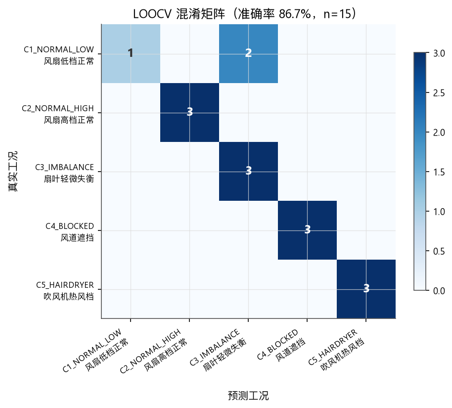

*LOOCV 混淆矩阵*

### 4. 盲测

| 试次 | 真实工况 | 表内预测 | 脚本重算 | 置信度 | 是否正确 | 一致 |
| --- | --- | --- | --- | --- | --- | --- |
| 1 | C1_NORMAL_LOW | C1_NORMAL_LOW | C1_NORMAL_LOW | 0.60 | ✓ | 是 |
| 2 | C1_NORMAL_LOW | C2_NORMAL_HIGH | C2_NORMAL_HIGH | 1.00 | ✗ | 是 |
| 3 | C1_NORMAL_LOW | C1_NORMAL_LOW | C1_NORMAL_LOW | 0.34 | ✓ | 是 |
| 4 | C2_NORMAL_HIGH | C2_NORMAL_HIGH | C2_NORMAL_HIGH | 1.00 | ✓ | 是 |
| 5 | C2_NORMAL_HIGH | C2_NORMAL_HIGH | C2_NORMAL_HIGH | 1.00 | ✓ | 是 |
| 6 | C2_NORMAL_HIGH | C2_NORMAL_HIGH | C2_NORMAL_HIGH | 1.00 | ✓ | 是 |
| 7 | C3_IMBALANCE | C3_IMBALANCE | C3_IMBALANCE | 0.66 | ✓ | 是 |
| 8 | C3_IMBALANCE | C3_IMBALANCE | C3_IMBALANCE | 1.00 | ✓ | 是 |
| 9 | C3_IMBALANCE | C3_IMBALANCE | C3_IMBALANCE | 1.00 | ✓ | 是 |
| 10 | C4_BLOCKED | C4_BLOCKED | C4_BLOCKED | 1.00 | ✓ | 是 |
| 11 | C4_BLOCKED | C4_BLOCKED | C4_BLOCKED | 1.00 | ✓ | 是 |
| 12 | C4_BLOCKED | C4_BLOCKED | C4_BLOCKED | 0.69 | ✓ | 是 |
| 13 | C5_HAIRDRYER | C5_HAIRDRYER | C5_HAIRDRYER | 1.00 | ✓ | 是 |
| 14 | C5_HAIRDRYER | C5_HAIRDRYER | C5_HAIRDRYER | 1.00 | ✓ | 是 |
| 15 | C5_HAIRDRYER | C5_HAIRDRYER | C5_HAIRDRYER | 1.00 | ✓ | 是 |

- 盲测表（blind_test_VD-20261118-001.csv）记录的准确率：93.3%；脚本按 features_file 重新提取特征再预测的准确率：93.3%；两者一致率 100.0%。
- 盲测样本不参与训练；预测发生在揭示真实标签之前（App 侧记录），此处用脚本复核可复现性。

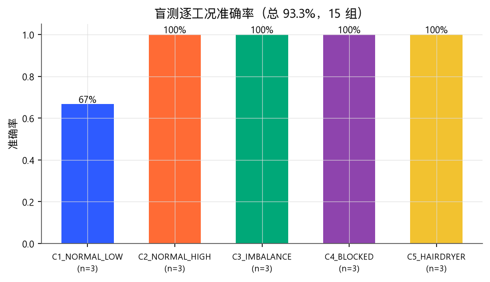

*盲测逐工况准确率*

### 5. 抗噪测试

| SNR / dB | 白噪声（加噪） | 粉红噪声（加噪） | 白噪声（去噪后） | 粉红噪声（去噪后） |
| --- | --- | --- | --- | --- |
| 20 | 1.0 | 1.0 | 1.0 | 1.0 |
| 10 | 0.5 | 1.0 | 1.0 | 1.0 |
| 5 | 0.2 | 0.5 | 1.0 | 1.0 |
| 0 | 0.2 | 0.2 | 0.2 | 0.7 |
| -5 | 0.2 | 0.2 | 0.2 | 0.2 |

口径：噪声按目标 SNR 叠加到整段音频（峰值超满量程时整体缩放以保持 SNR），重新提取全部音频特征（振动特征沿用干净数据），再用干净训练集分类；去噪 = 单次全局 FFT 谱减法（噪声底取 20% 分位，α=1.5）。

- 白噪声：SNR 20 dB 时准确率 100.0%，SNR 5 dB 时降至 20.0%；低于 0.6 的失效点出现在 SNR ≈ 10 dB。
  - 谱减法去噪在 SNR ≤5 dB 区间平均提升 +26.7%（最大 +80.0%）。
- 粉红噪声：SNR 20 dB 时准确率 100.0%，SNR 0 dB 时降至 20.0%；低于 0.6 的失效点出现在 SNR ≈ 5 dB。
  - 谱减法去噪在 SNR ≤5 dB 区间平均提升 +31.1%（最大 +46.7%）。

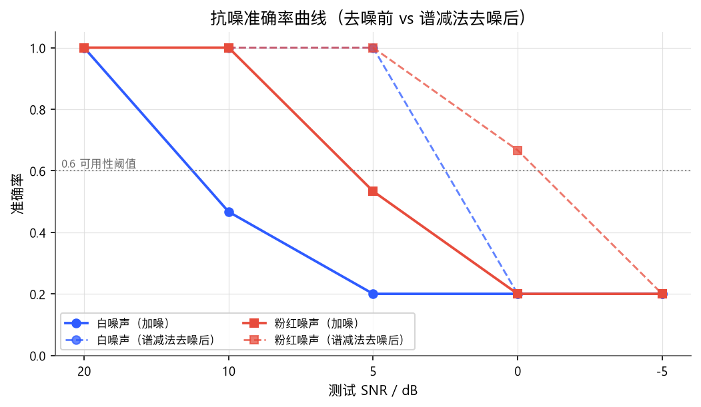

*抗噪准确率曲线（去噪前后）*

### 6. 误差分析

主要混淆对（真实 → 被误判）：

- C1_NORMAL_LOW → C3_IMBALANCE：2 次

可能原因（结合特征分布）：
1. **C1/C3 边界**：低档正常与轻微失衡的基频相同，差异主要体现在 1x 振动幅值、边带与谐波占比；失衡程度轻时与正常样本重叠，kNN 容易互相误判。
2. **C4/C5 高频特性**：遮挡后的宽带噪声与吹风机的高频宽带在频带占比与平坦度上相近，若麦克风高频响应受限或环境噪声偏大，两者容易混淆。
3. **C4/C1 低频重叠**：遮挡工况仍保留基频与谐波，只在高频滚降/频谱质心上与正常工况区分，距离度量需要对这些特征有足够权重（z-score 后等权，可能放大噪声特征）。
4. **录制差异**：手机摆放位置、距离、档位、环境噪声会引入组间漂移；同一工况内不同组若参数波动较大，LOOCV 泛化会下降。

### 7. 工程改进方向

1. **补足数据量**：真机实验按 5 工况 × 15 组采集；组间打散顺序、每 5 组休息，减少温漂与记忆效应。
2. **特征选择/加权**：对 32 维特征做类间可分性筛选（如 Fisher 比、互信息），或按特征组分别标准化、给振动/音频不同权重，减少噪声特征对距离的贡献。
3. **抗噪训练**：把加噪样本加入训练集（数据增强），或先用参考噪声录音做谱减/维纳滤波，再提取特征；本报告显示谱减法在低 SNR 有正收益。
4. **拒识机制**：置信度低于阈值时输出“无法判断”，避免把陌生声源强行归到 5 类之一。
5. **模型升级**：样本量足够后可对比 kNN 与 LDA/SVM（课程允许范围内），或对音频用 log-mel + 距离度量；但需保持端侧可解释与可复现。
6. **端侧一致性**：持续用同一份 WAV 在 App 与 Python 交叉验证（相对误差 <1e-3），并把模型参数写进 evaluation JSON，保证手机端与报告结果一致。

### 8. 复现方式

~~~powershell
python analysis/vibro/analyze.py --data data/raw/vibro/<session> --out analysis/out/vibro
python analysis/vibro/features.py   # 单文件自检：1 kHz 正弦峰值/频带断言
~~~

# 第四部分：跨课题综合小结（待填写）

> 以下内容需要结合真机实验数据人工撰写；本节给出填写框架。

## 4.1 三个课题的共同方法论

- 统一的数据契约（docs/DATA_DICTIONARY.md）让 Android 采集端与 Python 分析端字段、单位、空值规则一致；
- 统一的可复现实验流程：App 采集 → data/raw → analysis/ 管线 → 报告与图表；
- 统一的误差观：先做完整性/异常校验，再做统计与建模，最后明确写出局限。

## 4.2 主要量化结论（填写模板）

- 功耗：____ 工况平均功率最高（____ W），比待机高 ____ 倍；最有效的省电手段是 ____，预计可省 ____ W。
- 无线：____ 点位为盲区，主要由 ____ 材质遮挡导致；补点后预计 RSSI 提升 ____ dB。
- 声振：LOOCV 准确率 ____%，盲测 ____%；在 SNR ____ dB 以下需要降噪或加噪训练。

## 4.3 反思与改进

- 采样规模与统计显著性；
- 跨设备一致性（不同机型/麦克风/电池）；
- 从“课程级实验”走向“可复用的评测方法”还缺什么。

# 第五部分：复现步骤

~~~powershell
# 0) 安装依赖（numpy / pandas / matplotlib）
python -m pip install -r analysis/requirements.txt

# 1) 生成/准备数据：演示数据（synthetic）或真机数据
python data/demo/generate_demo.py

# 2) 三条分析管线
python analysis/power/analyze.py --data data/demo/power/20261118_PC-20261118-001 --out analysis/out/power
python analysis/wifi/analyze.py --data data/demo/wifi/20261118_WS-20261118-001 --out analysis/out/wifi
python analysis/vibro/analyze.py --data data/demo/vibro/20261118_VD-20261118-001 --out analysis/out/vibro

# 3) 合并总报告草稿
python analysis/report/build_report.py

# 4) 一键端到端自检
python analysis/tests/run_all.py
~~~

---

## 附录：本次生成的分析产物清单

### power

- power/figures/battery_curve.png
- power/figures/condition_compare.png
- power/figures/module_attribution.png
- power/figures/power_current.png
- power/figures/temperature.png
- power/figures/thermal_throttle.png
- power/tables/attribution_fit.csv
- power/tables/condition_metrics.csv
- power/tables/energy_crosscheck.csv
- power/tables/increment_decomposition.csv
- power/tables/module_attribution.csv
- power/tables/sample_quality.csv
- power/tables/thermal_analysis.csv
- power/power_report.md

### wifi

- wifi/figures/attenuation_material_box.png
- wifi/figures/blind_zone_map.png
- wifi/figures/interference.png
- wifi/figures/latency_dist.png
- wifi/figures/pathloss_fit.png
- wifi/figures/rssi_bar.png
- wifi/tables/blind_zone_grades.csv
- wifi/tables/channel_occupancy.csv
- wifi/tables/interference.csv
- wifi/tables/material_attenuation.csv
- wifi/tables/multipath_correlation.csv
- wifi/tables/pathloss_fit.csv
- wifi/tables/pathloss_points.csv
- wifi/tables/point_metrics.csv
- wifi/tables/survey_quality.csv
- wifi/wifi_report.md

### vibro

- vibro/figures/blind_test.png
- vibro/figures/confusion_matrix.png
- vibro/figures/feature_distribution.png
- vibro/figures/noise_accuracy.png
- vibro/figures/spectrum_compare.png
- vibro/tables/blind_test_results.csv
- vibro/tables/dataset_check.csv
- vibro/tables/feature_crosscheck.csv
- vibro/tables/features_all.csv
- vibro/tables/loocv_confusion.csv
- vibro/tables/noise_accuracy.csv
- vibro/tables/per_condition_accuracy.csv
- vibro/vibro_report.md
- vibro/evaluation_VD-20261118-001.json

