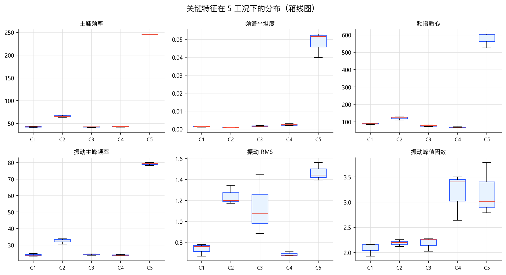
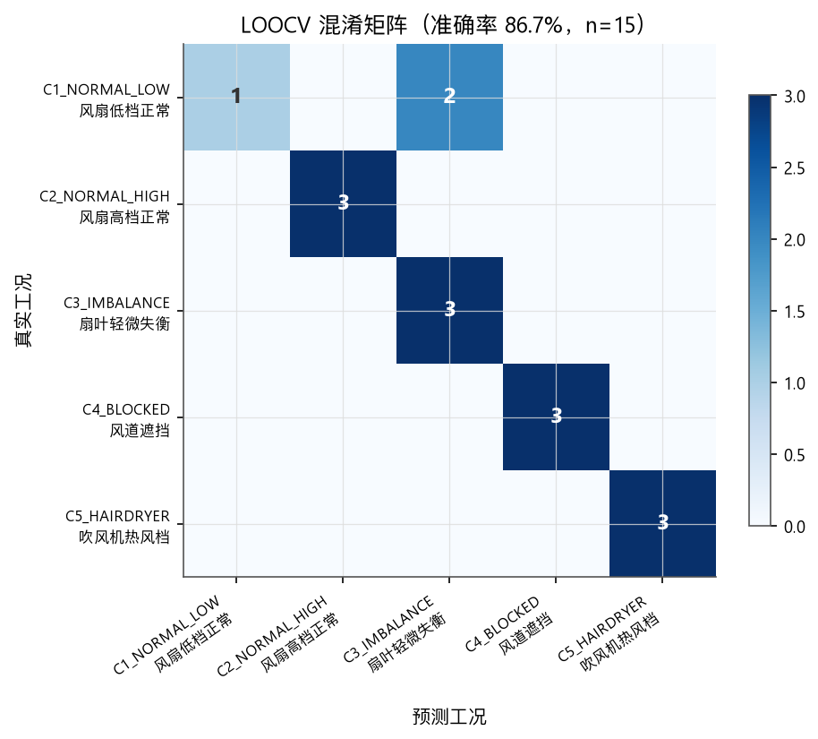
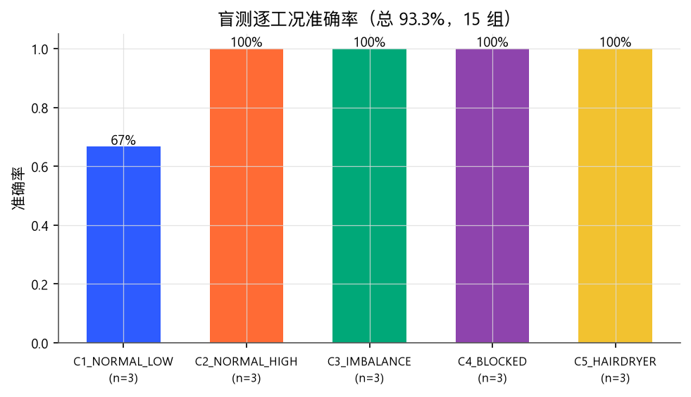
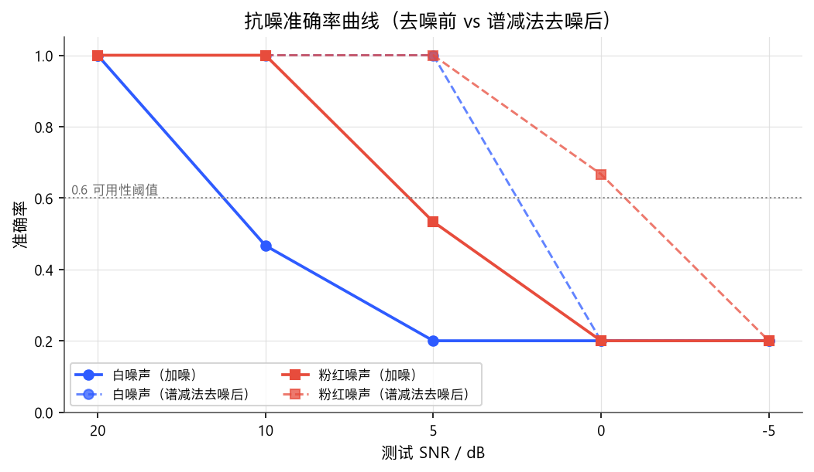

# 项目三 · 手机声振诊断仪 —— 分析报告

> 由 analysis/vibro/analyze.py 自动生成；特征定义见 docs/feature_spec.md，分类器为 z-score + kNN(k=3)，纯 numpy 实现。
>
> **本报告使用的是 data/demo 合成演示数据（SYNTHETIC），仅用于验证分析管线，不能作为课程报告的真实测量结论。** 换成 data/raw 下的真机数据后重跑即可。

## 摘要

本批数据共 15 组样本（5 工况，每组 3–3 组），提取 32 维声振特征。z-score + kNN(k=3) 的留一法（LOOCV）准确率为 **86.7%**；各工况准确率：C1_NORMAL_LOW 33%、C2_NORMAL_HIGH 100%、C3_IMBALANCE 100%、C4_BLOCKED 100%、C5_HAIRDRYER 100%。
盲测 15 组（不参与训练）的准确率为 **93.3%**，盲测表内预测与脚本重算预测的一致率为 100.0%。
抗噪：SNR 10 dB 时白噪声下准确率 46.7%，0 dB 时白噪声 20.0%、粉红噪声 20.0%；详细曲线见第 5 节。

**会话**：VD-20261118-001；**样本目录**：E:/phone function/phone-lab/data/demo/vibro/20261118_VD-20261118-001；**设备**：Pixel 7。

## 1. 数据与完整性

| 工况 | 已采集组数 | 目标组数 | complete |
| --- | --- | --- | --- |
| C1_NORMAL_LOW | 3 | 3 | 1 |
| C2_NORMAL_HIGH | 3 | 3 | 1 |
| C3_IMBALANCE | 3 | 3 | 1 |
| C4_BLOCKED | 3 | 3 | 1 |
| C5_HAIRDRYER | 3 | 3 | 1 |

| 工况 | 实际样本组数 | 工况标签 |
| --- | --- | --- |
| C1_NORMAL_LOW | 3 | 风扇低档正常 |
| C2_NORMAL_HIGH | 3 | 风扇高档正常 |
| C3_IMBALANCE | 3 | 扇叶轻微失衡 |
| C4_BLOCKED | 3 | 风道遮挡 |
| C5_HAIRDRYER | 3 | 吹风机热风档 |

- 特征交叉校验：脚本按 WAV 重算的特征与 App 写出 features.csv 相比，最大绝对误差 5.000e-07、最大相对误差 4.794e-04（小于 feature_spec 要求的 1e-3 量级）。
- ✅ 5 工况样本齐全，dataset_index 与实际样本一致。

## 2. 特征工程

| 特征组 | 维度 | 代表特征 | 物理意义 |
| --- | --- | --- | --- |
| 音频时域 | 6 | audio_rms_dbfs / crest / zcr / kurtosis | 响度、峰值因数、过零率、冲击性，区分风扇与吹风机 |
| 音频频域 | 7 | audio_centroid_hz / rolloff85 / flatness / harmonic_ratio / hnr_db | 音色亮度、高频滚降、谐波结构；失衡带来边带、遮挡带来高频衰减 |
| 音频频带 | 7 | band_0_100 … band_10k_20k | 能量分布；吹风机高频宽带、遮挡后高频能量下降 |
| 振动时域 | 4 | accel_rms / peak / crest / zcr | 振动强度与冲击性；失衡时 1x 振动明显增大 |
| 振动频域 | 3 | accel_peak_hz / centroid_hz / flatness | 转频与频谱形状 |
| 振动频带 | 5 | accel_band_0_5 … accel_band_50_100 | 低频转频、中高频轴承/气流振动占比 |

完整特征定义见 docs/feature_spec.md；本脚本实现与 App 的 FeatureExtractor 逐条对齐（帧起点/谱归一化/频带分母/谐波 bin/短帧补零等约定），共 32 个数值特征 + 6 个标签列 = 38 列。

*关键特征在 5 工况下的分布*

## 3. 分类结果（LOOCV）

- LOOCV 准确率：**86.7%**（15 折）。
- 训练集自检（resubstitution，仅参考）：100.0%。
- 标准化与 k：每折重新拟合 z-score（训练折均值/标准差，标准差为 0 时置 1），k = 3，欧氏距离，1/(d+eps) 加权投票，平票取最近邻类别。

混淆矩阵（行=真实，列=预测）：

| 真实\预测 | C1_NORMAL_LOW | C2_NORMAL_HIGH | C3_IMBALANCE | C4_BLOCKED | C5_HAIRDRYER |
| --- | --- | --- | --- | --- | --- |
| C1_NORMAL_LOW | 1 | 0 | 2 | 0 | 0 |
| C2_NORMAL_HIGH | 0 | 3 | 0 | 0 | 0 |
| C3_IMBALANCE | 0 | 0 | 3 | 0 | 0 |
| C4_BLOCKED | 0 | 0 | 0 | 3 | 0 |
| C5_HAIRDRYER | 0 | 0 | 0 | 0 | 3 |

| 工况 | 样本数 | 准确率 | 错分数 |
| --- | --- | --- | --- |
| C1_NORMAL_LOW | 3 | 33% | 2 |
| C2_NORMAL_HIGH | 3 | 100% | 0 |
| C3_IMBALANCE | 3 | 100% | 0 |
| C4_BLOCKED | 3 | 100% | 0 |
| C5_HAIRDRYER | 3 | 100% | 0 |

*LOOCV 混淆矩阵*

## 4. 盲测

| 试次 | 真实工况 | 表内预测 | 脚本重算 | 置信度 | 是否正确 | 一致 |
| --- | --- | --- | --- | --- | --- | --- |
| 1 | C1_NORMAL_LOW | C1_NORMAL_LOW | C1_NORMAL_LOW | 0.60 | ✓ | 是 |
| 2 | C1_NORMAL_LOW | C2_NORMAL_HIGH | C2_NORMAL_HIGH | 1.00 | ✗ | 是 |
| 3 | C1_NORMAL_LOW | C1_NORMAL_LOW | C1_NORMAL_LOW | 0.34 | ✓ | 是 |
| 4 | C2_NORMAL_HIGH | C2_NORMAL_HIGH | C2_NORMAL_HIGH | 1.00 | ✓ | 是 |
| 5 | C2_NORMAL_HIGH | C2_NORMAL_HIGH | C2_NORMAL_HIGH | 1.00 | ✓ | 是 |
| 6 | C2_NORMAL_HIGH | C2_NORMAL_HIGH | C2_NORMAL_HIGH | 1.00 | ✓ | 是 |
| 7 | C3_IMBALANCE | C3_IMBALANCE | C3_IMBALANCE | 0.66 | ✓ | 是 |
| 8 | C3_IMBALANCE | C3_IMBALANCE | C3_IMBALANCE | 1.00 | ✓ | 是 |
| 9 | C3_IMBALANCE | C3_IMBALANCE | C3_IMBALANCE | 1.00 | ✓ | 是 |
| 10 | C4_BLOCKED | C4_BLOCKED | C4_BLOCKED | 1.00 | ✓ | 是 |
| 11 | C4_BLOCKED | C4_BLOCKED | C4_BLOCKED | 1.00 | ✓ | 是 |
| 12 | C4_BLOCKED | C4_BLOCKED | C4_BLOCKED | 0.69 | ✓ | 是 |
| 13 | C5_HAIRDRYER | C5_HAIRDRYER | C5_HAIRDRYER | 1.00 | ✓ | 是 |
| 14 | C5_HAIRDRYER | C5_HAIRDRYER | C5_HAIRDRYER | 1.00 | ✓ | 是 |
| 15 | C5_HAIRDRYER | C5_HAIRDRYER | C5_HAIRDRYER | 1.00 | ✓ | 是 |

- 盲测表（blind_test_VD-20261118-001.csv）记录的准确率：93.3%；脚本按 features_file 重新提取特征再预测的准确率：93.3%；两者一致率 100.0%。
- 盲测样本不参与训练；预测发生在揭示真实标签之前（App 侧记录），此处用脚本复核可复现性。

*盲测逐工况准确率*

## 5. 抗噪测试

| SNR / dB | 白噪声（加噪） | 粉红噪声（加噪） | 白噪声（去噪后） | 粉红噪声（去噪后） |
| --- | --- | --- | --- | --- |
| 20 | 1.0 | 1.0 | 1.0 | 1.0 |
| 10 | 0.5 | 1.0 | 1.0 | 1.0 |
| 5 | 0.2 | 0.5 | 1.0 | 1.0 |
| 0 | 0.2 | 0.2 | 0.2 | 0.7 |
| -5 | 0.2 | 0.2 | 0.2 | 0.2 |

口径：噪声按目标 SNR 叠加到整段音频（峰值超满量程时整体缩放以保持 SNR），重新提取全部音频特征（振动特征沿用干净数据），再用干净训练集分类；去噪 = 单次全局 FFT 谱减法（噪声底取 20% 分位，α=1.5）。

- 白噪声：SNR 20 dB 时准确率 100.0%，SNR 5 dB 时降至 20.0%；低于 0.6 的失效点出现在 SNR ≈ 10 dB。
  - 谱减法去噪在 SNR ≤5 dB 区间平均提升 +26.7%（最大 +80.0%）。
- 粉红噪声：SNR 20 dB 时准确率 100.0%，SNR 0 dB 时降至 20.0%；低于 0.6 的失效点出现在 SNR ≈ 5 dB。
  - 谱减法去噪在 SNR ≤5 dB 区间平均提升 +31.1%（最大 +46.7%）。

*抗噪准确率曲线（去噪前后）*

## 6. 误差分析

主要混淆对（真实 → 被误判）：

- C1_NORMAL_LOW → C3_IMBALANCE：2 次

可能原因（结合特征分布）：
1. **C1/C3 边界**：低档正常与轻微失衡的基频相同，差异主要体现在 1x 振动幅值、边带与谐波占比；失衡程度轻时与正常样本重叠，kNN 容易互相误判。
2. **C4/C5 高频特性**：遮挡后的宽带噪声与吹风机的高频宽带在频带占比与平坦度上相近，若麦克风高频响应受限或环境噪声偏大，两者容易混淆。
3. **C4/C1 低频重叠**：遮挡工况仍保留基频与谐波，只在高频滚降/频谱质心上与正常工况区分，距离度量需要对这些特征有足够权重（z-score 后等权，可能放大噪声特征）。
4. **录制差异**：手机摆放位置、距离、档位、环境噪声会引入组间漂移；同一工况内不同组若参数波动较大，LOOCV 泛化会下降。

## 7. 工程改进方向

1. **补足数据量**：真机实验按 5 工况 × 15 组采集；组间打散顺序、每 5 组休息，减少温漂与记忆效应。
2. **特征选择/加权**：对 32 维特征做类间可分性筛选（如 Fisher 比、互信息），或按特征组分别标准化、给振动/音频不同权重，减少噪声特征对距离的贡献。
3. **抗噪训练**：把加噪样本加入训练集（数据增强），或先用参考噪声录音做谱减/维纳滤波，再提取特征；本报告显示谱减法在低 SNR 有正收益。
4. **拒识机制**：置信度低于阈值时输出“无法判断”，避免把陌生声源强行归到 5 类之一。
5. **模型升级**：样本量足够后可对比 kNN 与 LDA/SVM（课程允许范围内），或对音频用 log-mel + 距离度量；但需保持端侧可解释与可复现。
6. **端侧一致性**：持续用同一份 WAV 在 App 与 Python 交叉验证（相对误差 <1e-3），并把模型参数写进 evaluation JSON，保证手机端与报告结果一致。

## 8. 复现方式

~~~powershell
python analysis/vibro/analyze.py --data data/raw/vibro/<session> --out analysis/out/vibro
python analysis/vibro/features.py   # 单文件自检：1 kHz 正弦峰值/频带断言
~~~
