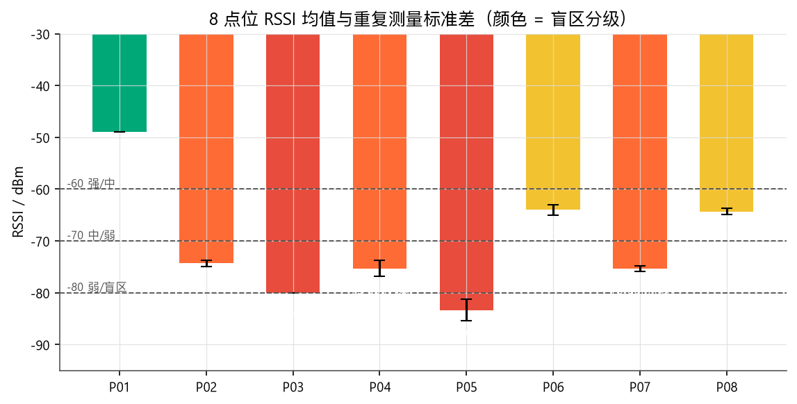
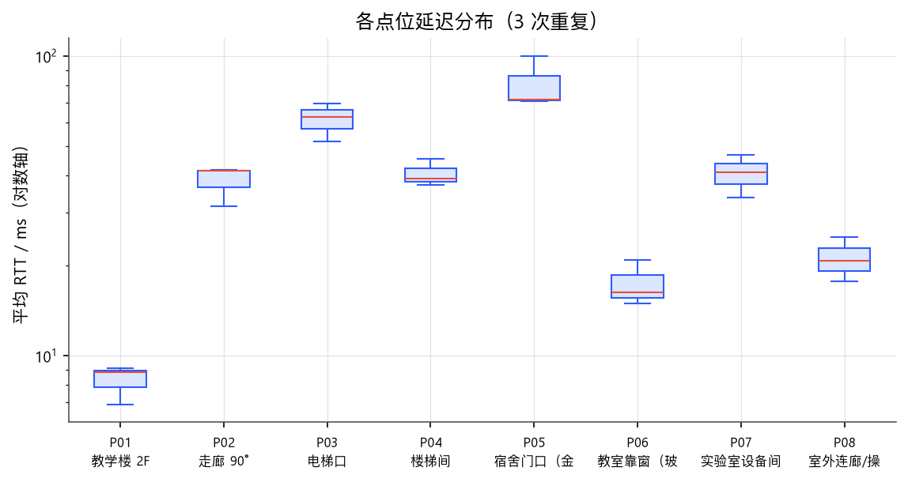
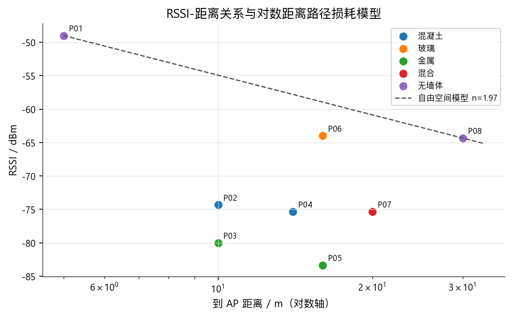
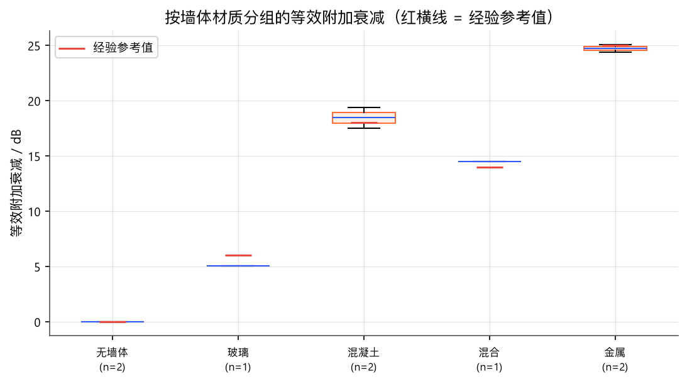
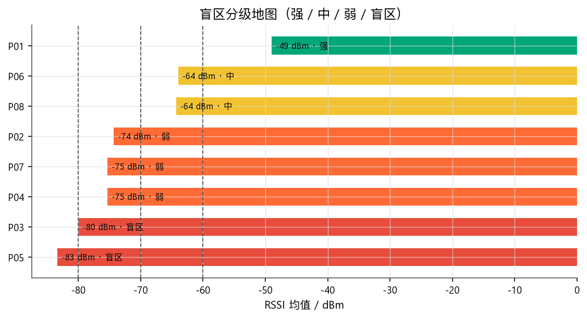
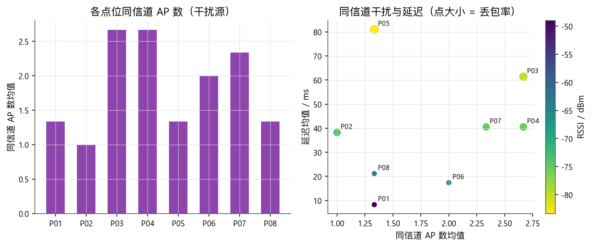

# 课题03 · 教学楼/宿舍无线信号盲区测绘 —— 分析报告

> 由 analysis/wifi/analyze.py 自动生成；方法口径与局限见文末。
>
> **本报告使用的是 data/demo 合成演示数据（SYNTHETIC），仅用于验证分析管线，不能作为课程报告的真实测量结论。** 换成 data/raw 下的真机数据后重跑即可。

## 摘要

本次测绘共 8 个点位 × 3 次重复，得到 24 行有效记录。盲区分级：强 1 个、中 2 个、弱 3 个、盲区 2 个。以 P01（5.0 m，-49.0 dBm）为参考，拟合路径损耗指数 n = 1.97；混凝土等效附加衰减 18.5 dB、金属 24.7 dB、玻璃 5.0 dB，与经验值同量级。最差点位见第 5 节分级表与改善建议。

**会话**：WS-20261118-001；**样本目录**：E:/phone function/phone-lab/data/demo/wifi/20261118_WS-20261118-001；**设备**：Pixel 7。

## 1. 点位设计与测量方法

| 点位 | 名称 | 类型 | 墙体材质 | 遮挡描述 | 到 AP 距离 m | 楼层 | 现场照片 |
| --- | --- | --- | --- | --- | --- | --- | --- |
| P01 | 教学楼 2F 走廊中段（基准点） | corridor | 无墙体 | 无墙体遮挡，AP 在走廊上方吊顶内 | 5.0 | — | （占位） |
| P02 | 走廊 90° 转角 | corner | 混凝土 | 两侧承重墙，转角 90°，非视距 | 10.0 | — | （占位） |
| P03 | 电梯口 | elevator | 金属 | 金属电梯门与井道，强反射 | 10.0 | — | （占位） |
| P04 | 楼梯间 | stairwell | 混凝土 | 混凝土楼梯间隔墙 + 上下楼层反射 | 14.0 | — | （占位） |
| P05 | 宿舍门口（金属门） | dorm | 金属 | 金属防盗门关闭，门缝泄漏 | 16.0 | — | （占位） |
| P06 | 教室靠窗（玻璃幕墙） | classroom | 玻璃 | 单层玻璃幕墙 + 窗帘 | 16.0 | — | （占位） |
| P07 | 实验室设备间（机柜） | lab | 混合 | 机柜金属板 + 轻质隔墙混合 | 20.0 | — | （占位） |
| P08 | 室外连廊/操场 | outdoor | 无墙体 | 无墙体，视距但距离远 | 30.0 | — | （占位） |

- 测量口径：每点位 3 次重复、间隔 ≥30 s；每次 20 次 TCP RTT（223.5.5.5:443，超时 1000 ms）、5 次 HTTP GET（TTFB/总耗时）、5 次网关 TCP 建连；App 保持前台、屏幕常亮。
- 同一点位 3 次重复的位置、朝向保持一致（地面标记），同一时段完成 8 个点位以减少网络负载漂移。
- 定位开关必须打开（Android 12+ 读取 RSSI/扫描结果的前提）；扫描受限时记录 note。
- 照片占位：真机实验请按 SOP 拍摄墙体与 AP 方向照片，命名 photos/<pointId>_<stamp>.jpg。

## 2. 数据完整性与质量

| 点位 | 重复次数 | 缺失重复 | scan 明细 | 非法 RSSI 行 | 延迟缺失 | 丢包缺失 |
| --- | --- | --- | --- | --- | --- | --- |
| P01 | 3 | 无 | 3 | 0 | 0 | 0 |
| P02 | 3 | 无 | 3 | 0 | 0 | 0 |
| P03 | 3 | 无 | 3 | 0 | 0 | 0 |
| P04 | 3 | 无 | 3 | 0 | 0 | 0 |
| P05 | 3 | 无 | 3 | 0 | 0 | 0 |
| P06 | 3 | 无 | 3 | 0 | 0 | 0 |
| P07 | 3 | 无 | 3 | 0 | 0 | 0 |
| P08 | 3 | 无 | 3 | 0 | 0 | 0 |

- ✅ 24 行齐全（8 点位 × 3 次），每点位均有 scan 明细，RSSI 均在合理区间。

## 3. 点位测量结果

| 点位 | RSSI 均值 dBm | RSSI 标准差 dB | 延迟均值 ms | 延迟 P95 ms | 抖动 ms | 丢包 % | 稳定性 % |
| --- | --- | --- | --- | --- | --- | --- | --- |
| P01 | -49.0 | 0.00 | 8.3 | 18.5 | 1.4 | 0.00 | 100.0 |
| P02 | -74.3 | 0.58 | 38.2 | 90.1 | 6.4 | 4.03 | 99.2 |
| P03 | -80.0 | 0.00 | 61.4 | 150.6 | 13.3 | 6.47 | 100.0 |
| P04 | -75.3 | 1.53 | 40.6 | 96.4 | 8.0 | 4.47 | 98.0 |
| P05 | -83.3 | 2.08 | 81.0 | 196.2 | 14.5 | 8.03 | 97.5 |
| P06 | -64.0 | 1.00 | 17.4 | 39.5 | 3.2 | 0.00 | 98.4 |
| P07 | -75.3 | 0.58 | 40.5 | 100.5 | 10.4 | 4.00 | 99.2 |
| P08 | -64.3 | 0.58 | 21.2 | 48.9 | 4.3 | 0.00 | 99.1 |

稳定性评分 = 100 × (1 - min(1, RSSI 标准差 / |RSSI 均值|))，用于衡量同一位置重复测量的可复现性。

*8 点位 RSSI 均值与标准差*

*各点位延迟分布*

## 4. 墙体材质与多径衰减分析

自由空间参考：P01 距离 5.0 m、RSSI -49.0 dBm；路径损耗指数 n = 1.97（无遮挡点位最小二乘拟合（2 点））。无遮挡点位拟合 R² = 1.000；每个点位的等效附加衰减 = 自由空间预测 - 实测。

| 材质 | 点位数 | 点位 | 均值 dB | 中位数 dB | 标准差 dB | 经验参考 dB | 与参考差 dB |
| --- | --- | --- | --- | --- | --- | --- | --- |
| 无墙体 | 2 | P01;P08 | 0.0 | 0.0 | 0.0 | 0 | 0.0 |
| 玻璃 | 1 | P06 | 5.0 | 5.0 | 0.0 | 6 | -1.0 |
| 混凝土 | 2 | P02;P04 | 18.5 | 18.5 | 1.3 | 18 | 0.5 |
| 混合 | 1 | P07 | 14.5 | 14.5 | 0.0 | 14 | 0.5 |
| 金属 | 2 | P03;P05 | 24.7 | 24.7 | 0.5 | 25 | -0.3 |

- 结论框架：混凝土约 -18 dB、金属约 -25 dB、玻璃约 -6 dB、混合材质约 -14 dB；实测均值与经验值的偏差反映墙体厚度、含水率、入射角度与多径叠加，写入报告时应结合实际点位描述解释偏差。

*RSSI-距离关系与路径损耗拟合*

*按材质分组的等效附加衰减*

### 4.2 多径与相关性

| 指标 A | 指标 B | Pearson r | Spearman rho | 解读 |
| --- | --- | --- | --- | --- |
| RSSI 标准差 | 附加衰减 | 0.35 | 0.18 | 弱正相关（r=0.35） |
| RSSI 标准差 | 延迟抖动 | 0.38 | 0.32 | 弱正相关（r=0.38） |
| RSSI 标准差 | 遮挡复杂度编码 | 0.30 | 0.21 | 弱正相关（r=0.30） |
| 延迟抖动 | 附加衰减 | 0.89 | 0.84 | 强正相关（r=0.89） |
| 延迟 P95 | 附加衰减 | 0.91 | 0.84 | 强正相关（r=0.91） |
| RSSI 均值 | 延迟均值 | -0.90 | -0.99 | 强负相关（r=-0.90） |
| RSSI 均值 | 丢包率 | -0.89 | -0.93 | 强负相关（r=-0.89） |
| 同信道 AP 数 | 延迟均值 | 0.19 | 0.38 | 几乎无正相关（r=0.19） |
| 最强同信道 RSSI | 延迟均值 | -0.91 | -0.98 | 强负相关（r=-0.91） |

多径判读：RSSI 标准差与延迟抖动越大，说明非视距/强反射越明显；金属与转角点位的抖动通常显著高于视距点位，符合多径衰落规律。

## 5. 邻道干扰与盲区分级

| 点位 | 同信道 AP 数均值 | 最多 | 最强同信道 RSSI dBm | 邻信道 AP 数均值 | 延迟均值 ms | 丢包 % |
| --- | --- | --- | --- | --- | --- | --- |
| P01 | 1.3 | 2 | -50.3 | 0.0 | 8.3 | 0.00 |
| P02 | 1.0 | 2 | -73.5 | 0.0 | 38.2 | 4.03 |
| P03 | 2.7 | 5 | -79.7 | 0.0 | 61.4 | 6.47 |
| P04 | 2.7 | 4 | -75.7 | 0.0 | 40.6 | 4.47 |
| P05 | 1.3 | 2 | -86.0 | 0.0 | 81.0 | 8.03 |
| P06 | 2.0 | 3 | -63.0 | 0.0 | 17.4 | 0.00 |
| P07 | 2.3 | 5 | -79.3 | 0.0 | 40.5 | 4.00 |
| P08 | 1.3 | 3 | -66.5 | 0.0 | 21.2 | 0.00 |

| 点位 | 材质 | RSSI dBm | 延迟 P95 ms | 丢包 % | 分级 | 主要问题 | 建议 | 优先级 |
| --- | --- | --- | --- | --- | --- | --- | --- | --- |
| P01 | 无墙体 | -49.0 | 18.5 | 0.00 | 强 | 指标基本可用 | 无需处理；可作为其他点位的参考基准 | P3 |
| P08 | 无墙体 | -64.3 | 48.9 | 0.00 | 中 | 指标基本可用 | 保持观察；若该区域有高码率业务，优先考虑启用 5G 频段 | P2 |
| P06 | 玻璃 | -64.0 | 39.5 | 0.00 | 中 | 指标基本可用 | 保持观察；若该区域有高码率业务，优先考虑启用 5G 频段 | P2 |
| P04 | 混凝土 | -75.3 | 96.4 | 4.47 | 弱 | 延迟 P95 过高（多径/拥塞） | 增加 AP 补点或调整现有 AP 天线方向；该点位优先切 5G | P1 |
| P07 | 混合 | -75.3 | 100.5 | 4.00 | 弱 | 延迟 P95 过高（多径/拥塞） | 增加 AP 补点或调整现有 AP 天线方向；该点位优先切 5G | P1 |
| P02 | 混凝土 | -74.3 | 90.1 | 4.03 | 弱 | 延迟 P95 过高（多径/拥塞） | 增加 AP 补点或调整现有 AP 天线方向；该点位优先切 5G | P1 |
| P05 | 金属 | -83.3 | 196.2 | 8.03 | 盲区 | RSSI 低于 -80 dBm（覆盖不足） | 立即补点（走廊/门口附近新增 AP 或室分天线）并做信道规划 | P0 |
| P03 | 金属 | -80.0 | 150.6 | 6.47 | 盲区 | 丢包率过高（重传/干扰） | 立即补点（走廊/门口附近新增 AP 或室分天线）并做信道规划 | P0 |

*盲区分级地图*

*同信道干扰与延迟*

## 6. 盲区改善建议

- **P04 楼梯间**（混凝土，RSSI -75 dBm，P95 96 ms，丢包 4.5%）：延迟 P95 过高（多径/拥塞）；建议：增加 AP 补点或调整现有 AP 天线方向；该点位优先切 5G。
- **P07 实验室设备间（机柜）**（混合，RSSI -75 dBm，P95 100 ms，丢包 4.0%）：延迟 P95 过高（多径/拥塞）；建议：增加 AP 补点或调整现有 AP 天线方向；该点位优先切 5G。
- **P02 走廊 90° 转角**（混凝土，RSSI -74 dBm，P95 90 ms，丢包 4.0%）：延迟 P95 过高（多径/拥塞）；建议：增加 AP 补点或调整现有 AP 天线方向；该点位优先切 5G。
- **P05 宿舍门口（金属门）**（金属，RSSI -83 dBm，P95 196 ms，丢包 8.0%）：RSSI 低于 -80 dBm（覆盖不足）；建议：立即补点（走廊/门口附近新增 AP 或室分天线）并做信道规划。
- **P03 电梯口**（金属，RSSI -80 dBm，P95 151 ms，丢包 6.5%）：丢包率过高（重传/干扰）；建议：立即补点（走廊/门口附近新增 AP 或室分天线）并做信道规划。
- 混凝土：实测等效附加衰减 18.5 dB（经验参考 18 dB）；穿墙场景应优先把 AP 放到走廊侧。
- 金属：实测 24.7 dB（经验 25 dB）；电梯口/金属门内基本无法穿透，建议用走廊侧 AP + 泄漏电缆/室分覆盖门口区域。
- 玻璃：实测 5.0 dB（经验 6 dB）；玻璃幕墙对 2.4G 损耗小，但窗外反射会带来多径抖动，靠近窗边建议锁 5G 频段。
- 信道规划：各点位同信道 AP 数均值 1.8（最多 5 个），最强同信道 RSSI 均值 -72 dBm；2.4G 应严格使用 1/6/11 三信道并降低发射功率，高密度区域（实验室/宿舍）优先 5G 频段与 80 MHz 以下带宽以减少重叠。
- 路径损耗模型：n = 1.97（无遮挡点位最小二乘拟合（2 点）），自由空间拟合 R² = 1.000
- 补点原则：优先在“转角后/金属门内/楼梯间”等非视距位置补点；新增 AP 与最弱点位距离控制在覆盖半径内，并用 5G 回传减少 2.4G 同频干扰。

## 7. 局限与改进

1. **样本量**：每点 3 次重复只能给出粗粒度标准差；要区分多径波动与测量噪声，建议每点 ≥10 次。
2. **单 AP 关联**：RSSI 只反映关联 AP，不反映邻区整体覆盖；盲区判定应结合扫描明细与 AP 布点图。
3. **距离估计**：distance_m 是估算值（平面图量取），误差直接进入路径损耗模型；若能拿到 AP 精确坐标，应改用射线追踪或实测标定。
4. **n 的标定**：本分析只用无遮挡点位拟合 n。若整栋楼几乎没有视距点位，n 会被墙体损耗污染，应在报告里说明或使用同楼层走廊长度做标定。
5. **干扰指标**：scan 结果受 Android 扫描节流影响可能不完整；同信道 AP 数只能作为干扰代理，不能替代频谱分析仪。
6. **时间漂移**：RSSI 与网络负载随时间变化，8 个点位应尽量在同一时段完成，并记录测试时间。

## 8. 复现方式

~~~powershell
python analysis/wifi/analyze.py --data data/raw/wifi/<session> --out analysis/out/wifi
~~~
