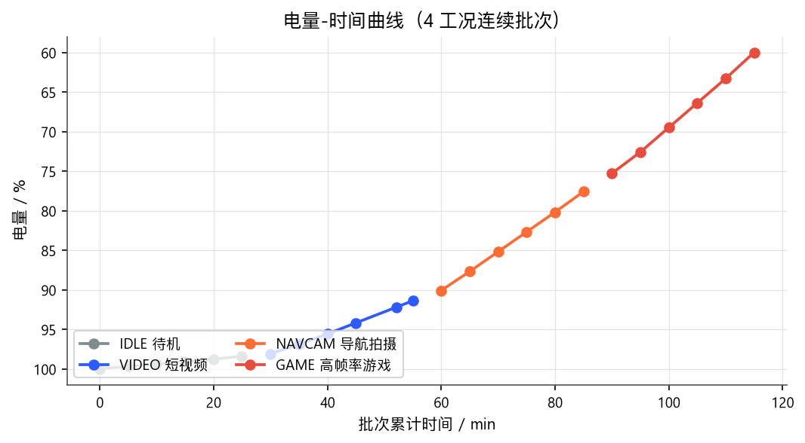
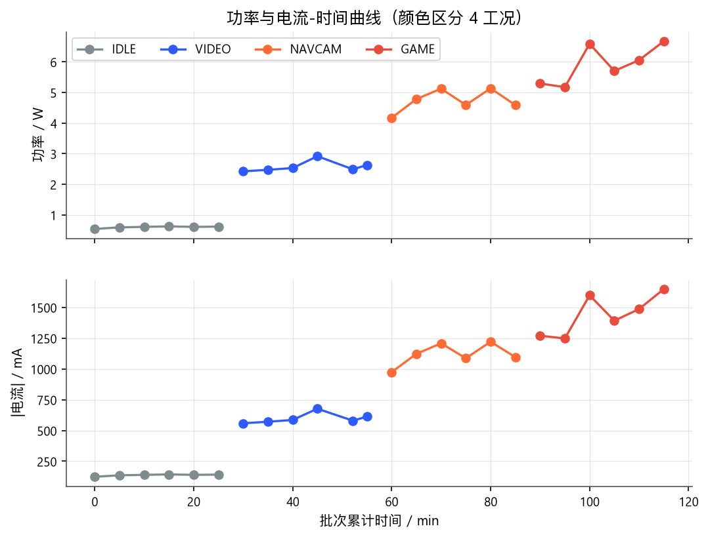
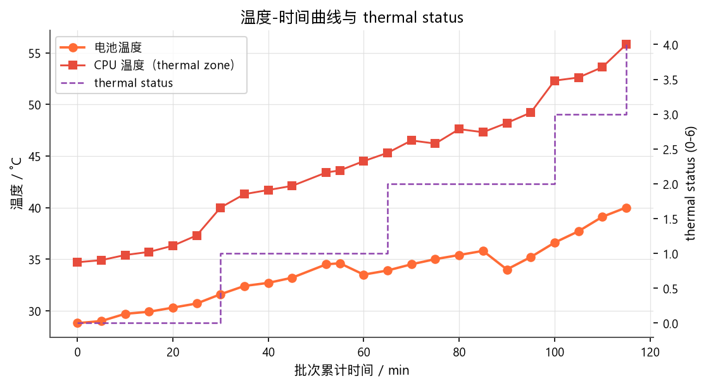
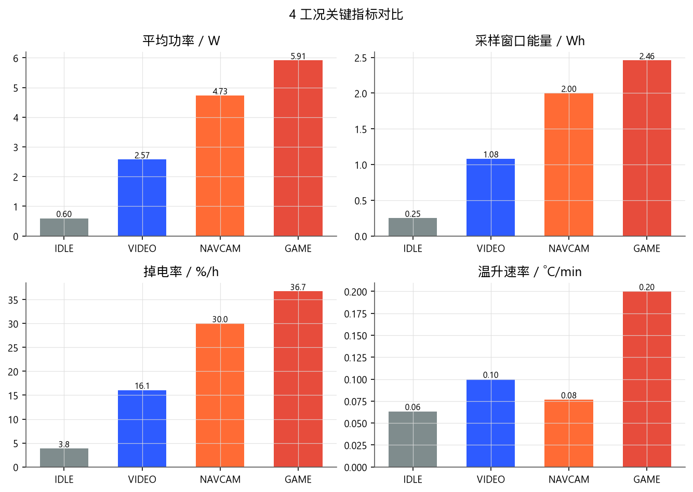
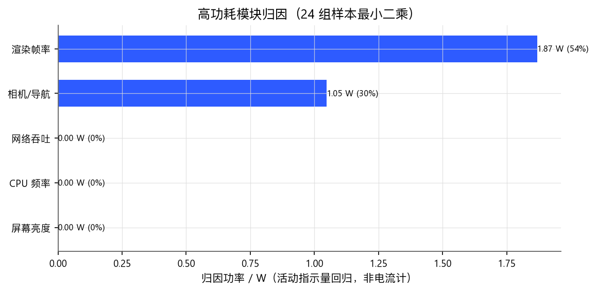
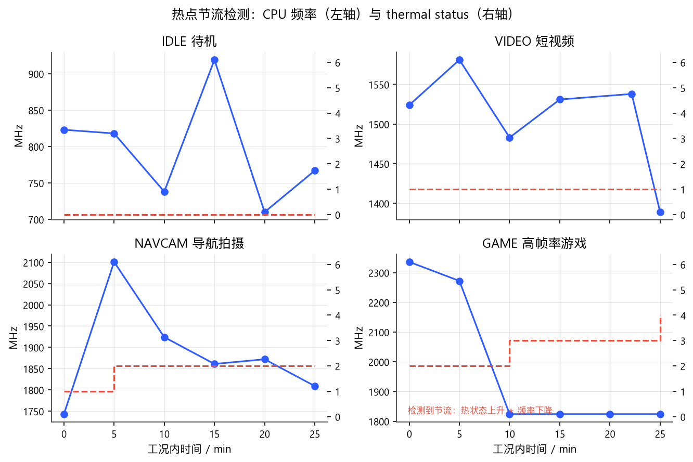

# 课题02 · 个人手机多工况发热与掉电实测

> **报告模板使用说明**
> 1. 本模板中的 `____` 与表格占位需要填入**真机实测**数据（`data/raw/power/<session>`）；
> 2. 图表路径对应 `analysis/out/power/figures/`，运行
>    `python analysis/power/analyze.py --data data/raw/power/<session> --out analysis/out/power`
>    后自动生成；`data/demo` 生成的是 synthetic 演示图，不能直接当课程结果使用；
> 3. 报告结构：摘要 → 方法（设备/工况/采样口径/误差来源）→ 结果（24 组表与图表）→
>    高功耗模块归因 → 省电策略 → 局限与改进 → 附录。

| 项目 | 内容 |
|---|---|
| 姓名 / 学号 | ____ / ____ |
| 课程 / 班级 | ____ |
| 实验日期 | ____ |
| 设备型号 | ____（如 Pixel 7 / Android 14 / Tensor G2） |
| 数据批次 | ____（`PC-____`，见 manifest.json） |

## 摘要

> 写作框架（约 250–350 字）：一句话背景 → 做了什么（4 工况 × 30 min、每 5 min 采样）→
> 关键数字（各工况平均功率、最高温升、最大掉电率、热节流是否出现）→ 最重要的两条结论。

本文面向“手机在多工况下的发热与掉电”问题，使用自研 PowerTrace App 对 ____ 手机在
待机 / 短视频 / 导航拍摄 / 高帧率游戏 4 种工况下各连续采集 30 min，每 5 min 记录一次电量、
电流、电压、电池温度、thermal status、CPU 频率与网络吞吐，共获得 ____ 个有效采样点。
结果显示：待机平均功率 ____ W，短视频 ____ W，导航拍摄 ____ W，游戏 ____ W；
电池温度分别上升 ____ / ____ / ____ / ____ °C；最大掉电率出现在 ____ 工况（____ %/h）。
通过“活动指示量回归”与“工况增量分解”两种方式对高功耗模块进行归因，
发现 ____ 是占比最高的活动项（约 ____%），并在 ____ 工况观察到热节流
（thermal status 上升且 CPU 平均频率下降 ____%）。据此提出 ____ 等省电建议。

**关键词**：手机功耗；发热；掉电率；活动指示量回归；热节流

## 1. 实验目的

1. 量化 4 类典型使用场景下手机的平均功率、能量消耗、掉电速率与温升速率；
2. 解释“电都花在哪了”：在无法接入硬件电流计的条件下，用可观测的活动指示量做功耗归因；
3. 观察长时间高负载下的热节流现象，理解性能/功耗/温度三者的权衡；
4. 基于实测数据提出可执行的省电策略，并写出方法与结论的局限。

## 2. 实验方法

### 2.1 设备与环境

| 项 | 值 |
|---|---|
| 机型 / SoC | ____ |
| Android / SDK | ____ |
| 屏幕刷新率 / 亮度 | ____ Hz / 固定 ____%（关闭自动亮度） |
| 电池设计容量 | ____ mAh（`BATTERY_PROPERTY_CHARGE_COUNTER` 上限） |
| 环境温度 / 湿度 | ____ °C / ____ % |
| 网络 | ____（同一 WiFi / 同一位置） |
| 起始电量 / 温度 | ____ % / ____ °C（未充电） |

> 填写提示：从 `manifest.json` 的 device 字段与 App 首页设备卡抄录；起始温度 >35 °C 时应先静置降温。

### 2.2 工况定义

| 顺序 | 工况 ID | 中文名 | 操作定义 | 备注 |
|---|---|---|---|---|
| A | IDLE | 待机 | 锁屏息屏放置 30 min，不移动 | 关闭 AOD，通知保留 |
| B | VIDEO | 短视频 | 固定同一 App 连续播放，音量 50% | 记录 App 名称/分辨率 |
| C | NAVCAM | 导航拍摄 | 导航 15 min + 1080p 录像 15 min，定位与相机常开 | 记录是否开高精度定位 |
| D | GAME | 高帧率游戏 | 同一游戏、同一画质/帧率 | 记录帧率设置（60/90/120） |

- 工况之间静置 10 min 降温，并记录起始电量差；
- 每个工况开始前在 App 内填写 note（App 名称、设置、环境），结束后立即导出该工况 CSV。

### 2.3 采样口径

- 采样间隔固定 300 s，每工况 6 个采样点（0/5/10/15/20/25 min，第 6 点对应 25 min）；
- 每次采样短持 wake lock（≤8 s），采样结束立即释放，不整场持锁（避免污染待机功耗）；
- 功率换算：`power_w = battery_voltage_mv × |current_now_ua| / 1e9`；`CURRENT_NOW` 符号厂商相关，
  分析统一取绝对值并在报告中注明；
- 电量以系统 `battery_level_pct` 为主；`charge_counter_uah` 用于能量交叉校验；
- 缺失/迟到：迟到 >90 s 的采样点照常写入并标 `late_sample`，不静默丢弃；
- 充电状态必须为 0；出现 `charging=1` 的批次作废重跑。

### 2.4 指标定义

| 指标 | 定义 | 单位 |
|---|---|---|
| 平均功率 | 工况内 6 点 `power_w` 算术平均 | W |
| 峰值功率 | 工况内 `power_w` 最大值 | W |
| 能量 | 采样时间轴梯形积分（0–25 min 窗口） | Wh |
| 掉电率 | (起始电量 − 结束电量) / 采样时长 | %/h |
| 温升速率 | (末点电池温度 − 首点) / 工况分钟数 | °C/min |
| thermal 峰值 | 工况内 `thermal_status` 最大值（0–6） | — |
| 热节流 | thermal status 上升 **且** CPU 平均频率后半段较前半段下降 ≥5% | 布尔 |

### 2.5 误差来源

1. **电流采样误差**：`CURRENT_NOW` 是瞬时值，受采样时刻负载波动影响，6 点均值只能近似工况平均；
2. **时间误差**：Doze/后台限制会导致采样迟到，迟到点按真实时间戳参与积分；
3. **电量计误差**：库仑计存在积分漂移，电量百分比是四舍五入值（1% 分辨率）；
4. **温度误差**：电池温度 = 机身表面温度代理，不等于电芯内部温度；CPU 温度为 thermal zone 最大值；
5. **环境漂移**：室温、网络负载、后台同步无法完全一致，跨工况比较需控制顺序（已用 A→B→C→D 固定顺序与 10 min 降温）；
6. **归因共线性**：亮度/CPU 频率/帧率在 4 工况中高度相关，回归系数不能唯一分解（见第 4 节声明）。

## 3. 结果

### 3.1 数据完整性

> 由 `analysis/out/power/tables/sample_quality.csv` 与报告第 1 节填写。

| 工况 | 行数 | 缺失采样点 | 迟到样本 | 充电异常 | 电量回升 | 功率重算误差 |
|---|---|---|---|---|---|---|
| IDLE | 6 | ____ | ____ | ____ | ____ | ____ |
| VIDEO | 6 | ____ | ____ | ____ | ____ | ____ |
| NAVCAM | 6 | ____ | ____ | ____ | ____ | ____ |
| GAME | 6 | ____ | ____ | ____ | ____ | ____ |

结论：____（如“24 行齐全，无迟到/充电异常，power_w 重算一致，数据可用于分析”）。

### 3.2 24 组时间序列表

> 表太大时只贴关键列；完整 24 行见 `analysis/out/power/tables/` 或原始 `campaign_*.csv`。

| 工况 | 采样点 | 累计时间 min | 电量 % | 电压 mV | 电流 mA | 功率 W | 电池温度 °C | CPU 温度 °C | thermal |
|---|---|---|---|---|---|---|---|---|---|
| IDLE | 1–6 | 0…25 | ____ | ____ | ____ | ____ | ____ | ____ | ____ |
| VIDEO | 1–6 | 0…25 | ____ | ____ | ____ | ____ | ____ | ____ | ____ |
| NAVCAM | 1–6 | 0…25 | ____ | ____ | ____ | ____ | ____ | ____ | ____ |
| GAME | 1–6 | 0…25 | ____ | ____ | ____ | ____ | ____ | ____ | ____ |

### 3.3 图表



*图 2-1 电量-时间曲线（4 工况连续批次）*



*图 2-2 功率/电流-时间曲线*



*图 2-3 电池/CPU 温度与 thermal status*



*图 2-4 平均功率、能量、掉电率、温升速率对比*

### 3.4 工况对比

> 从 `analysis/out/power/tables/condition_metrics.csv` 填入。

| 工况 | 平均功率 W | 峰值 W | 能量 Wh | 掉电 % | 掉电率 %/h | 温升 °C | 温升速率 °C/min | thermal 峰值 |
|---|---|---|---|---|---|---|---|---|
| IDLE | ____ | ____ | ____ | ____ | ____ | ____ | ____ | ____ |
| VIDEO | ____ | ____ | ____ | ____ | ____ | ____ | ____ | ____ |
| NAVCAM | ____ | ____ | ____ | ____ | ____ | ____ | ____ | ____ |
| GAME | ____ | ____ | ____ | ____ | ____ | ____ | ____ | ____ |

分析要点（写作框架）：

- 功率排序：____ 最高、____ 最低，最高/最低倍数约 ____；
- 能量与掉电率的一致性：____（能量积分与 charge_counter 差分偏差 ____%，说明电量计/采样是否可靠）；
- 温升与功率的关系：____（哪类工况单位功率的温升更高，为什么：相机/GPU 持续负载 vs 屏幕）；
- 与预期对比：____（如游戏平均功率低于预期，原因是画质/帧率设置或热节流）。

## 4. 高功耗模块归因

### 4.1 方法声明（必须保留）

> **本节是“活动指示量回归”，不是硬件电流计。** 手机的 SoC/PMIC 不为每个子系统提供独立电流采样，
> 只能用可观测的活动指示量（屏幕亮度、CPU 平均频率、网络吞吐、帧率代理、相机/导航工况指示量）
> 对整机功率做最小二乘拟合，得到“在该活动水平下平均功率增加多少”的估计。
> 共线指示量之间无法唯一分解；非负约束下被剔除的项按 0 计入。
> 因此这些 Watt 数字用于**解释与排序**，不能等同于“屏幕模块真实耗电 x W”。

### 4.2 回归结果

> 从 `analysis/out/power/tables/module_attribution.csv` 填入；R²/RMSE 见报告第 3 节。

| 模块 | 活动指示量 | 系数 | 单位 | 归因功率 W | 占总功耗 % | 备注 |
|---|---|---|---|---|---|---|
| 基线（待机/系统固定开销） | 1 | ____ | W | ____ | ____ | |
| 屏幕亮度 | 亮度 / 100 | ____ | W / 100% 亮度 | ____ | ____ | |
| CPU 频率 | 频率 / 1 GHz | ____ | W / GHz | ____ | ____ | |
| 网络吞吐 | (rx+tx) / 1 Mbps | ____ | W / Mbps | ____ | ____ | |
| 渲染帧率 | fps / 60 | ____ | W / 60fps | ____ | ____ | |
| 相机/导航 | 工况 == NAVCAM | ____ | W | ____ | ____ | |

拟合质量：R² = ____，RMSE = ____ W，平均实测 ____ W，模型预测合计 ____ W。
被非负约束剔除的项：____（原因：____）。

### 4.3 工况增量分解（测量值交叉验证）

| 来源 | 工况区间 | 增量功率 W | 占批次平均功耗 % | 累计 W |
|---|---|---|---|---|
| 待机基线 | IDLE | ____ | ____ | ____ |
| 屏幕 + 视频解码 + 网络下行 | IDLE → VIDEO | ____ | ____ | ____ |
| 相机 + GNSS + 编码 + 上行 | VIDEO → NAVCAM | ____ | ____ | ____ |
| GPU/CPU 高帧率渲染 | NAVCAM → GAME | ____ | ____ | ____ |



*图 2-5 高功耗模块归因（活动指示量回归）*

**结论框架**：在本批数据中，____ 是最大的单一是活动增量来源；把两种归因方式对比，
一致的部分是 ____，不一致的部分是 ____（通常是共线性或被剔除项），
因此报告只对 ____ 给出定量结论，其余仅作趋势判断。

## 5. 热点与节流

> 从 `analysis/out/power/tables/thermal_analysis.csv` 填入。

| 工况 | thermal 起始 → 峰值 | CPU 频率前半/后半 MHz | 频率降幅 % | 是否节流 |
|---|---|---|---|---|
| IDLE | ____ | ____ | ____ | ____ |
| VIDEO | ____ | ____ | ____ | ____ |
| NAVCAM | ____ | ____ | ____ | ____ |
| GAME | ____ | ____ | ____ | ____ |



*图 2-6 热点节流检测（CPU 频率与 thermal status）*

**结论框架**：____ 工况出现热节流，触发温度约 ____ °C，频率下降 ____%；
节流后功率/帧率如何变化：____；对用户体验的影响：____（卡顿/降亮度/降帧）。

## 6. 系统省电策略建议

> 每一条都要尽量引用第 3/4 节的实测数字；没有数据支撑的策略用“建议验证”标注。

1. **屏幕与刷新率**：亮度从 ____% 降到 ____% 预计省 ____ W；高刷（90/120 Hz）在游戏外的收益有限，
   建议日常 60 Hz、游戏再切高刷。
2. **CPU/GPU 调度**：游戏锁帧 ____ fps、画质降一档，预计省 ____ W，并可推迟热节流出现时间。
3. **网络**：视频码率/自动清晰度、地图预加载、关闭后台同步与测速；导航拍摄时上行带宽是主要网络功耗。
4. **后台与传感器**：限制后台唤醒、关闭不必要定位精度（高精度 → 省电模式）、录像完立刻释放相机。
5. **温控**：避免边充边玩；高负载场景加散热背夹/取下手机壳；游戏工况前先降温到 ____ °C 以下。
6. **系统设置**：关闭 AOD、动态壁纸、常驻通知；电池优化设为“不限制”只在采集时需要，日常应恢复默认。

## 7. 局限与改进

1. **样本量**：4 工况 × 6 点 = 24 点，只能做趋势与量级判断；建议重复 3 个批次并做批间方差分析。
2. **归因方法**：活动指示量回归存在共线性与混杂，无法替代硬件电流计；若能使用外接功率计或 per-rail 电流，
   应重新标定归因系数。
3. **温度场**：单点电池温度不能代表整机温度分布；可用红外热像仪补一张热图作为附录。
4. **机型依赖**：结论只对该机型/该 Android 版本成立；更换机型需重跑标定。
5. **工况可控性**：短视频/游戏的内容差异会显著影响功耗，建议用固定视频文件与固定游戏场景复测。

## 8. 结论

> 三到五条，每条一个数字。

1. ____；
2. ____；
3. ____。

## 附录

### A. 复现命令

```powershell
python analysis/power/analyze.py --data data/raw/power/<session> --out analysis/out/power
```

### B. 数据与文件清单

| 文件 | 说明 |
|---|---|
| `data/raw/power/<session>/session_*.csv` | 4 个工况各 6 行原始采样 |
| `data/raw/power/<session>/campaign_*.csv` | 24 行合并表 |
| `data/raw/power/<session>/campaign_summary_*.csv` | App 生成的工况汇总（用于交叉校验） |
| `data/raw/power/<session>/manifest.json` | 设备与批次元数据 |
| `analysis/out/power/tables/*.csv` | 分析表格（质量、指标、归因、节流、增量分解） |
| `analysis/out/power/figures/*.png` | 图表 |

### C. 版本与工具

- App：PowerTrace ____（`appVersion`）
- 分析管线：`analysis/power/analyze.py`（numpy + pandas + matplotlib，无 scipy/sklearn）
- 提交/commit：____
