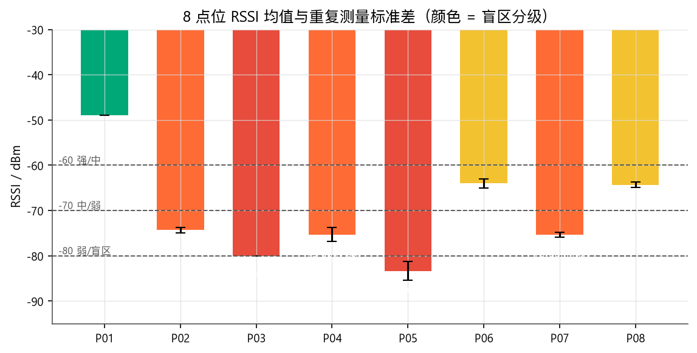
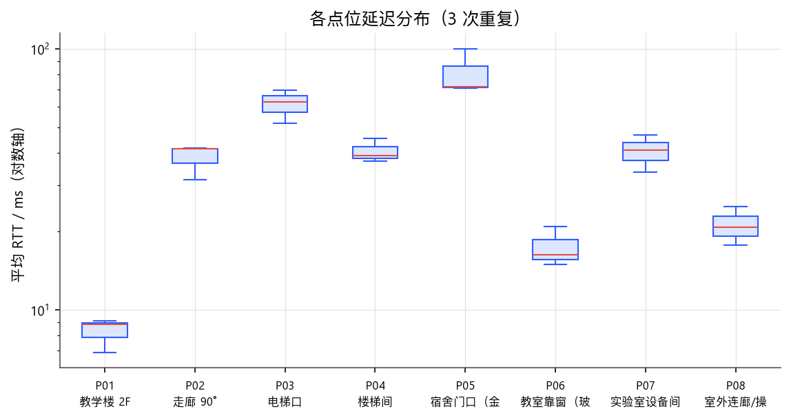
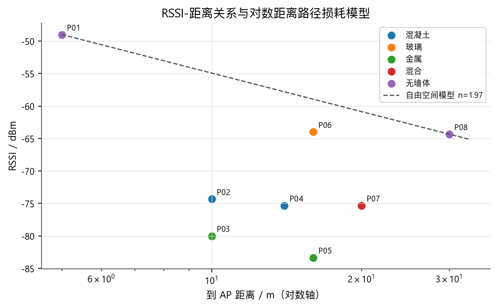
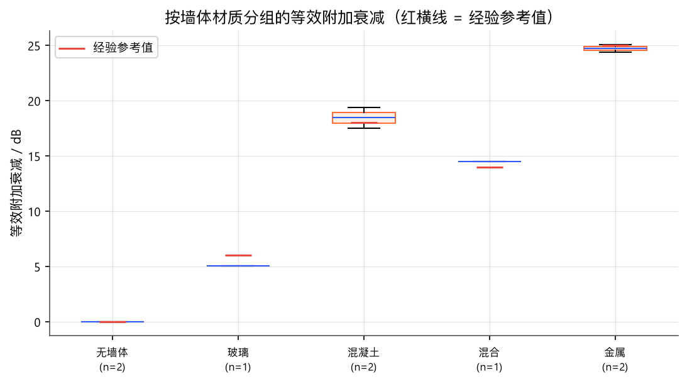
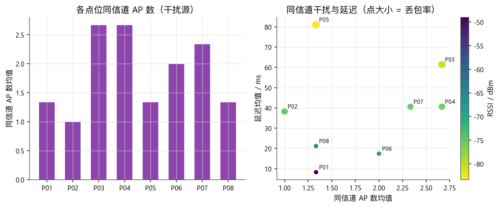
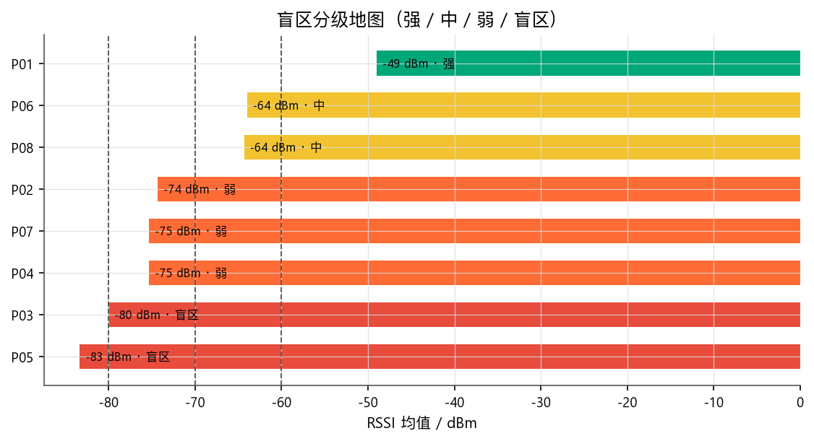

# 课题03 · 教学楼/宿舍无线信号盲区测绘

> **报告模板使用说明**
> 1. `____` 与表格占位需填入真机实测数据（`data/raw/wifi/<session>`）；
> 2. 图表路径对应 `analysis/out/wifi/figures/`，运行
>    `python analysis/wifi/analyze.py --data data/raw/wifi/<session> --out analysis/out/wifi`
>    后自动生成；demo 数据的图是 synthetic 演示图，不能当课程结果；
> 3. 报告结构：摘要 → 点位设计（8 点表格 + 照片占位）→ 测量方法 → 结果 →
>    墙体材质与多径衰减分析 → 盲区改善建议 → 局限。

| 项目 | 内容 |
|---|---|
| 姓名 / 学号 | ____ / ____ |
| 课程 / 班级 | ____ |
| 实验日期 / 时段 | ____（同一时段完成 8 点更佳） |
| 设备型号 | ____ |
| SSID / 频段 / 信道 | ____ / ____ / ____ |
| 数据会话 | ____（`WS-____`） |

## 摘要

> 写作框架（约 250–350 字）：为什么测（校园 WiFi 盲区）→ 怎么测（8 点位 × 3 次、RSSI + 延迟 + 扫描）→
> 关键数字（盲区点位数量、最差 RSSI、材质附加衰减、路径损耗指数）→ 最重要的两条改善建议。

本文使用自研 SignalMap App 在教学楼与宿舍选取 8 个具有不同遮挡特征的点位，每点位重复测量 3 次，
记录 RSSI、延迟（均值/P95/抖动）、丢包率、邻道扫描明细与现场照片，共 ____ 行有效数据。
以走廊基准点 P01 为参考建立对数距离路径损耗模型，拟合路径损耗指数 n = ____；
实测等效附加衰减：混凝土 ____ dB、金属 ____ dB、玻璃 ____ dB、混合 ____ dB。
按强/中/弱/盲区四级分级，____ 个点位为盲区（____），____ 个为弱覆盖（____）；
多径分析显示 RSSI 标准差与延迟抖动和遮挡复杂度呈 ____ 相关（r = ____）。
据此提出 ____ 等补点与信道规划建议。

**关键词**：RSSI；无线盲区；路径损耗；墙体衰减；多径；信道规划

## 1. 点位设计

| 点位 | 名称 | 类型 | 墙体材质 | 遮挡描述 | 到 AP 距离 m | 楼层 | 照片 |
|---|---|---|---|---|---|---|---|
| P01 | 教学楼 2F 走廊中段（基准点） | corridor | 无 | 视距，AP 在吊顶内 | ____ | 2 | `photos/P01_*.jpg` |
| P02 | 走廊 90° 转角 | corner | 混凝土 | 两侧承重墙，非视距 | ____ | 2 | `photos/P02_*.jpg` |
| P03 | 电梯口 | elevator | 金属 | 金属门与井道 | ____ | 2 | `photos/P03_*.jpg` |
| P04 | 楼梯间 | stairwell | 混凝土 | 隔墙 + 上下楼层反射 | ____ | 2 | `photos/P04_*.jpg` |
| P05 | 宿舍门口（金属门） | dorm | 金属 | 金属防盗门关闭 | ____ | 3 | `photos/P05_*.jpg` |
| P06 | 教室靠窗（玻璃幕墙） | classroom | 玻璃 | 单层玻璃 + 窗帘 | ____ | 2 | `photos/P06_*.jpg` |
| P07 | 实验室设备间（机柜） | lab | 混合 | 机柜金属板 + 轻质隔墙 | ____ | 1 | `photos/P07_*.jpg` |
| P08 | 室外连廊/操场 | outdoor | 无 | 视距但距离远 | ____ | 1 | `photos/P08_*.jpg` |

> 照片占位说明：按 SOP 拍摄“墙体 + AP 方向”，避免拍到人脸；照片放入
> `data/raw/wifi/<session>/photos/`，路径写入 `survey_*.csv` 的 `photo_file` 列。
> 报告里可每点插一张缩略图，例如：


*图 3-0 点位现场照片（占位）*

## 2. 测量方法

### 2.1 单点流程

1. 站在地面标记处，手机竖屏、与地面垂直、朝向一致（3 次重复位置相同）；
2. 打开 App → 选择点位 → 拍照 → 开始测量；
3. App 自动完成：连接信息（RSSI/链路速率/频段/信道）→ 邻道扫描 → 网关 TCP 建连 5 次 →
   互联网 TCP RTT 20 次（223.5.5.5:443，超时 1000 ms）→ HTTP GET 5 次（TTFB/总耗时）→ 写 CSV；
4. 同一时段完成 8 个点位，每点 3 次重复、间隔 ≥30 s。

### 2.2 环境控制

- 同一 SSID、同一频段（2.4G 或 5G 分开测，不要混）；
- 关闭热点/VPN/代理，屏幕常亮；定位开关必须打开（Android 12+ 读 RSSI/扫描的前提）；
- 避开下课高峰与大量下载时段，并记录测试时间。

### 2.3 指标定义

| 指标 | 定义 |
|---|---|
| RSSI 均值/标准差 | 同点位 3 次重复的算术均值 / 样本标准差 |
| 延迟均值 / P95 | 3 次重复的 `latency_avg_ms` 均值 / `latency_p95_ms` 均值 |
| 丢包率 | 3 次重复 `loss_pct` 均值 |
| 稳定性 | 100 × (1 − min(1, RSSI 标准差 / |RSSI 均值|)) |
| 等效附加衰减 | 自由空间预测 RSSI − 实测 RSSI（正数 = 额外损耗） |
| 盲区分级 | 强：RSSI ≥ −60 且丢包 <1%；中：≥ −70 且 <3%；弱：≥ −80 且 <6%；否则盲区 |

### 2.4 误差来源

1. RSSI 是芯片上报的整数 dBm，量化误差 ±1 dB，且受人体遮挡、朝向、握持方式影响；
2. 3 次重复的样本量小，标准差估计不稳定；
3. `distance_m` 是从平面图估算的，误差直接进入路径损耗模型；
4. 扫描结果受 Android 节流影响可能不完整，邻道干扰只能作为代理指标；
5. 网络负载随时间变化，延迟/丢包含非无线因素（服务器、代理、拥塞）。

## 3. 结果

### 3.1 数据完整性

> 从 `analysis/out/wifi/tables/survey_quality.csv` 填入。

| 点位 | 重复次数 | 缺失重复 | scan 明细 | 非法 RSSI 行 |
|---|---|---|---|---|
| P01–P08 | 3 | ____ | ____/3 | ____ |

结论：____（24 行齐全 / 异常点说明）。

### 3.2 点位测量结果

> 从 `analysis/out/wifi/tables/point_metrics.csv` 填入。

| 点位 | RSSI 均值 dBm | RSSI 标准差 dB | 延迟均值 ms | 延迟 P95 ms | 抖动 ms | 丢包 % | 稳定性 % |
|---|---|---|---|---|---|---|---|
| P01 | ____ | ____ | ____ | ____ | ____ | ____ | ____ |
| P02 | ____ | ____ | ____ | ____ | ____ | ____ | ____ |
| P03 | ____ | ____ | ____ | ____ | ____ | ____ | ____ |
| P04 | ____ | ____ | ____ | ____ | ____ | ____ | ____ |
| P05 | ____ | ____ | ____ | ____ | ____ | ____ | ____ |
| P06 | ____ | ____ | ____ | ____ | ____ | ____ | ____ |
| P07 | ____ | ____ | ____ | ____ | ____ | ____ | ____ |
| P08 | ____ | ____ | ____ | ____ | ____ | ____ | ____ |



*图 3-1 8 点位 RSSI 均值与重复测量标准差（颜色 = 盲区分级）*



*图 3-2 各点位延迟分布（3 次重复）*

**结果解读框架**：

- 最强/最弱点位：____（RSSI ____ dBm vs ____ dBm，相差 ____ dB）；
- 延迟与丢包：____ 点位 P95 延迟超过 ____ ms、丢包 ____%，已影响视频/游戏类业务；
- 稳定性：____ 点位重复测量波动最大（标准差 ____ dB），说明多径/遮挡不稳定。

## 4. 墙体材质与多径衰减分析

### 4.1 路径损耗模型

以 P01（距离 ____ m、RSSI ____ dBm）为参考，自由空间模型
`RSSI(d) = P0 − 10·n·log10(d/d0)`；只用无墙体点位拟合得到 **n = ____**（R² = ____）。
每个点位等效附加衰减 = 自由空间预测 − 实测：

| 点位 | 材质 | 距离 m | 自由空间预测 dBm | 实测 dBm | 等效附加衰减 dB |
|---|---|---|---|---|---|
| P01 | 无 | ____ | ____ | ____ | ____ |
| P02 | 混凝土 | ____ | ____ | ____ | ____ |
| P03 | 金属 | ____ | ____ | ____ | ____ |
| P04 | 混凝土 | ____ | ____ | ____ | ____ |
| P05 | 金属 | ____ | ____ | ____ | ____ |
| P06 | 玻璃 | ____ | ____ | ____ | ____ |
| P07 | 混合 | ____ | ____ | ____ | ____ |
| P08 | 无 | ____ | ____ | ____ | ____ |



*图 3-3 RSSI-距离关系与对数距离路径损耗模型*

### 4.2 按材质分组统计

> 从 `analysis/out/wifi/tables/material_attenuation.csv` 填入。

| 材质 | 点位数 | 均值 dB | 中位数 dB | 标准差 dB | 经验参考 dB | 与参考差 dB |
|---|---|---|---|---|---|---|
| 无墙体 | 2 | ____ | ____ | ____ | 0 | ____ |
| 玻璃 | 1 | ____ | ____ | ____ | 6 | ____ |
| 混凝土 | 2 | ____ | ____ | ____ | 18 | ____ |
| 混合 | 1 | ____ | ____ | ____ | 14 | ____ |
| 金属 | 2 | ____ | ____ | ____ | 25 | ____ |



*图 3-4 按墙体材质分组的等效附加衰减（红横线 = 经验参考值）*

**材质对照结论框架**（必须与实测均值一致，并解释偏差）：

- 混凝土：实测 ____ dB，与经验 18 dB 相比偏 ____，可能原因：墙厚/含水率/入射角/多径叠加；
- 金属：实测 ____ dB，金属门/电梯井几乎无法穿透，穿透路径主要靠门缝/走廊衍射；
- 玻璃：实测 ____ dB，单层玻璃损耗小，但窗外反射导致抖动 ____ dB；
- 混合：实测 ____ dB，介于混凝土与轻质隔墙之间。

### 4.3 多径与相关性

> 从 `analysis/out/wifi/tables/multipath_correlation.csv` 填入。

| 指标 A | 指标 B | Pearson r | Spearman ρ | 解读 |
|---|---|---|---|---|
| RSSI 标准差 | 附加衰减 | ____ | ____ | ____ |
| RSSI 标准差 | 延迟抖动 | ____ | ____ | ____ |
| 延迟抖动 | 附加衰减 | ____ | ____ | ____ |
| RSSI 均值 | 延迟均值 | ____ | ____ | ____ |
| RSSI 均值 | 丢包率 | ____ | ____ | ____ |
| 同信道 AP 数 | 延迟均值 | ____ | ____ | ____ |

**多径判读框架**：____ 点位的 RSSI 标准差（____ dB）和延迟抖动（____ ms）显著高于视距点位，
说明强反射/非视距；金属与转角点位的多径衰落最明显，与“金属反射 + 转角绕射”一致。

### 4.4 邻道干扰

> 从 `analysis/out/wifi/tables/interference.csv` 与 `channel_occupancy.csv` 填入。

| 点位 | 同信道 AP 数均值 | 最多 | 最强同信道 RSSI dBm | 邻信道 AP 数均值 |
|---|---|---|---|---|
| P01–P08 | ____ | ____ | ____ | ____ |



*图 3-5 同信道干扰与延迟的关系（点大小 = 丢包率）*

**结论**：本区域 2.4G 信道复用情况 ____；同信道 AP 与延迟的相关性 ____（r = ____），
说明干扰是延迟恶化的 ____ 因素之一。

## 5. 盲区分级与改善建议

### 5.1 分级结果

> 从 `analysis/out/wifi/tables/blind_zone_grades.csv` 填入。

| 点位 | 材质 | RSSI dBm | 延迟 P95 ms | 丢包 % | 分级 | 主要问题 | 优先级 |
|---|---|---|---|---|---|---|---|
| P01 | 无 | ____ | ____ | ____ | ____ | ____ | ____ |
| P02 | 混凝土 | ____ | ____ | ____ | ____ | ____ | ____ |
| P03 | 金属 | ____ | ____ | ____ | ____ | ____ | ____ |
| P04 | 混凝土 | ____ | ____ | ____ | ____ | ____ | ____ |
| P05 | 金属 | ____ | ____ | ____ | ____ | ____ | ____ |
| P06 | 玻璃 | ____ | ____ | ____ | ____ | ____ | ____ |
| P07 | 混合 | ____ | ____ | ____ | ____ | ____ | ____ |
| P08 | 无 | ____ | ____ | ____ | ____ | ____ | ____ |



*图 3-6 盲区分级地图*

### 5.2 改善建议

1. **AP 补点**：____ 点位（____）建议在 ____ 位置新增 AP/室分天线，预计 RSSI 提升 ____ dB 到 ____ dBm；
   ____ 点位可通过调整现有 AP 天线方向/下倾角解决。
2. **信道规划**：2.4G 严格使用 1/6/11，降低单 AP 发射功率并关闭 40 MHz 绑定；
   高密度区域（实验室/宿舍）优先 5G 频段与 ≤80 MHz 带宽，减少重叠覆盖与同频干扰。
3. **频段引导**：靠近窗口/视距点位优先 5G；金属/混凝土遮挡点位保持 2.4G 作为覆盖兜底。
4. **漫游与功率**：开启 802.11k/v 漫游，降低边缘 AP 的发射功率以减少“粘滞”与乒乓效应。
5. **验收复测**：补点后在同一时间窗复测同样 8 个点位，比较 RSSI、P95 延迟、丢包与分级变化。

## 6. 局限与改进

1. 每点 3 次重复只能给粗粒度统计；建议每点 ≥10 次或连续采 1 min 求均值。
2. 距离为估算值，路径损耗拟合受其误差影响；建议用 AP 精确坐标 + 平面图量测。
3. RSSI 只反映关联 AP，不能代表邻区整体覆盖；盲区判定应结合 AP 布点图与扫描明细。
4. 扫描明细受 Android 节流影响，同信道 AP 数只是干扰代理，不能替代频谱分析仪。
5. 结论仅对当前 AP 布点/发射功率/频段配置成立，环境变化（新增 AP、装修、人流）需复测。

## 附录

### A. 复现命令

```powershell
python analysis/wifi/analyze.py --data data/raw/wifi/<session> --out analysis/out/wifi
```

### B. 文件清单

| 文件 | 说明 |
|---|---|
| `data/raw/wifi/<session>/survey_*.csv` | 24 行测量主表 |
| `data/raw/wifi/<session>/points.csv` | 点位元数据 |
| `data/raw/wifi/<session>/scan_*.csv` | 邻道扫描明细 |
| `data/raw/wifi/<session>/photos/` | 现场照片 |
| `analysis/out/wifi/tables/*.csv` | 点位指标、路径损耗、材质衰减、多径、干扰、分级 |
| `analysis/out/wifi/figures/*.png` | 图表 |

### C. 版本

- App：SignalMap ____（`appVersion`）
- 分析管线：`analysis/wifi/analyze.py`（numpy + pandas + matplotlib）
- 提交/commit：____
