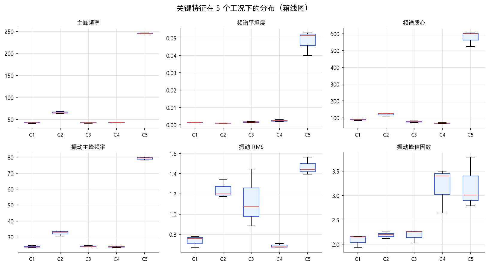
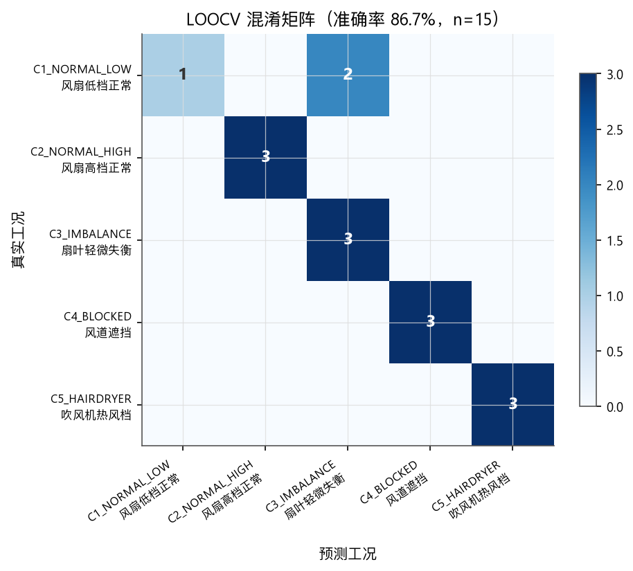
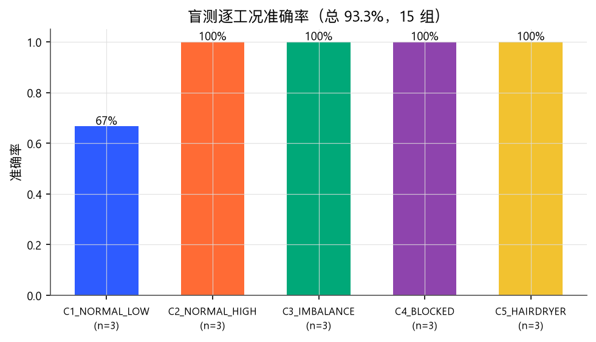
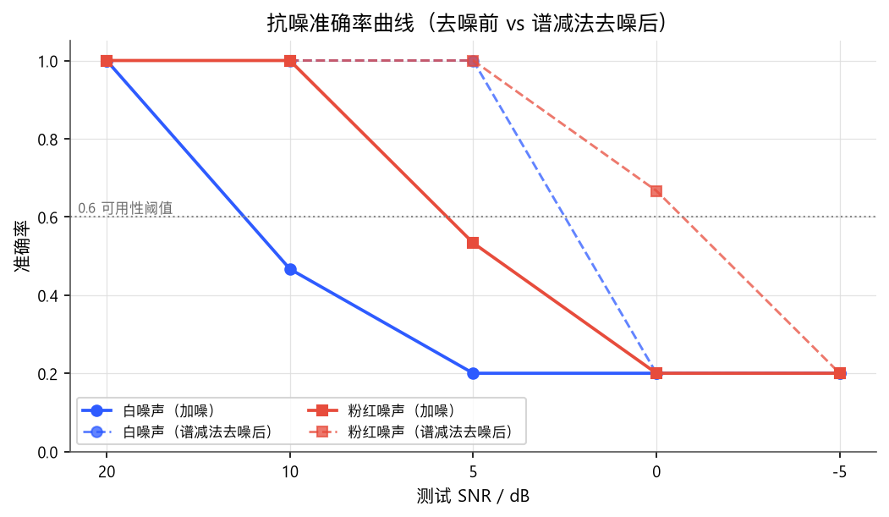
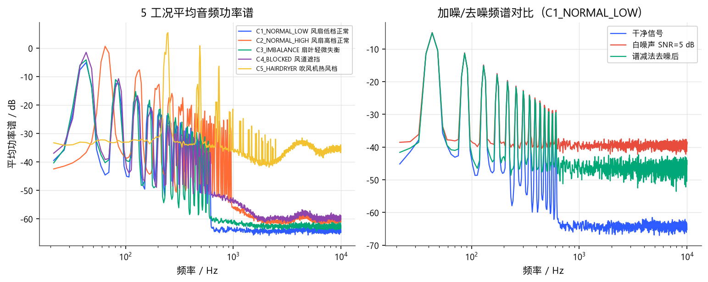

# 项目三 · 手机声振诊断仪（VibroDiag）

> **报告模板使用说明**
> 1. `____` 与表格占位需填入真机实测数据（`data/raw/vibro/<session>`）；
> 2. 图表路径对应 `analysis/out/vibro/figures/`，运行
>    `python analysis/vibro/analyze.py --data data/raw/vibro/<session> --out analysis/out/vibro`
>    后自动生成；demo 数据是 synthetic 演示数据，不能直接当课程结果；
> 3. 报告结构：摘要 → 系统设计 → 5 工况实验设计 → 特征工程 → 分类与盲测结果 →
>    抗噪测试 → 误差分析与工程改进 → 复现步骤。

| 项目 | 内容 |
|---|---|
| 姓名 / 学号 | ____ / ____ |
| 课程 / 班级 | ____ |
| 实验日期 / 时段 | ____ |
| 设备（风扇/吹风机） | ____（档位：____） |
| 手机型号 / 麦克风源 | ____ / ____（UNPROCESSED 或 MIC） |
| 数据会话 | ____（`VD-____`） |

## 摘要

> 写作框架（约 250–350 字）：要解决什么问题（声振诊断的可复现评测）→ 系统做了哪些部分
> （App 采集 + 端侧特征 + kNN + 盲测 + 抗噪）→ 关键数字（样本组数、特征维数、LOOCV/盲测准确率、
> 抗噪失效点）→ 结论与改进方向。

本项目实现了一台“手机声振诊断仪”：用手机麦克风与加速度计采集电风扇/吹风机在 5 种工况下的
声音与振动，按 `docs/feature_spec.md` 提取 ____ 维特征，用 z-score + kNN(k=3) 在手机端完成
分类、盲测与抗噪评估，并把同一套特征在 Python 侧重实现、交叉验证（相对误差 <1e-3）。
共采集 ____ 组样本（5 工况 × ____ 组/工况），留一法准确率 **____%**，盲测 ____ 组准确率 **____%**。
白噪声/粉红噪声注入实验显示：SNR ≥ ____ dB 时准确率仍 ≥ ____%，SNR 降至 ____ dB 时失效；
谱减法去噪在低 SNR 区间可提升 ____ 个百分点。误差集中于 ____ 与 ____ 两类工况。

**关键词**：声振诊断；FFT 特征；kNN；盲测；抗噪；端侧推理

## 1. 系统设计

### 1.1 总体架构

```
手机麦克风/加速度计
   │ AudioRecord 44.1kHz PCM16 + SensorManager 200Hz
   ▼
采集层（VibroDiag App）：WAV/CSV/meta.json/features.csv
   │ 特征提取（Kotlin，与 Python 同规格）
   ▼
模型层：z-score + kNN(k=3) → 预测/置信度/盲测/抗噪评估
   │ 数据集导出
   ▼
分析层（analysis/vibro）：特征复核、LOOCV、混淆矩阵、抗噪曲线、报告
```

### 1.2 关键设计决策

| 问题 | 方案 | 理由 |
|---|---|---|
| 音频质量 | `AudioSource.UNPROCESSED` 优先，回退 MIC；44.1 kHz / 单声道 / PCM16 | 避免 AGC/降噪破坏频谱特征 |
| 加速度采样 | 200 Hz（`HIGH_SAMPLING_RATE_SENSORS`），不可用回退 ~50 Hz | 风扇基频通常 <60 Hz，200 Hz 覆盖 4–6 阶谐波 |
| 特征一致性 | 规格文档 + Kotlin/Python 双实现 + 合成正弦单测 + 交叉验证 | 保证手机端实时分类与离线报告一致 |
| 模型 | z-score + kNN(k=3)，非深度模型 | 样本少、可解释、端侧秒级重训、面试可讲清 |
| 评估 | LOOCV + 独立盲测 + 抗噪评估 | 避免“训练集自测”高估 |

## 2. 5 工况实验设计

| 工况 ID | 中文名 | 设备/模拟方式 | 预期可区分特征 |
|---|---|---|---|
| C1_NORMAL_LOW | 风扇低档正常 | 电风扇 1 档，扇叶原状 | 基频 + 强谐波，振动 1× 较小 |
| C2_NORMAL_HIGH | 风扇高档正常 | 电风扇最大档 | 基频更高、整体更响、振动更大 |
| C3_IMBALANCE | 扇叶轻微失衡 | 1 片扇叶贴 ~2 g 配重片 | 1× 振动增强、边带、谐波比变化 |
| C4_BLOCKED | 风道遮挡 | 进风口遮挡 1/2 | 高频衰减 + 宽带噪声，频谱质心下降 |
| C5_HAIRDRYER | 吹风机热风档 | 吹风机高速热风 | 高频宽带、频谱平坦度高、主峰不同 |

采集规范：

- 每组 15 s（可配 5–30 s），每工况 15 组，共 75 组；组间轮换工况、每 5 组休息 1 min；
- 手机平放于设备正前方 30 cm，麦克风朝向设备，位置贴标固定；
- 环境安静（<40 dBA），记录环境噪声；异常（削波/脱落/时长不足）立即重录。

## 3. 特征工程

> 详细定义见 `docs/feature_spec.md`；所有窗函数为 Hann，音频 fftSize=4096、hop=2048，
> 功率谱 P=|FFT|²/N 多帧平均；振动 fftSize=min(4096, nextPow2(N))、hop=fftSize/2。

| 特征组 | 维度 | 特征 | 物理意义 |
|---|---|---|---|
| 音频时域 | 6 | audio_rms_dbfs, audio_peak_dbfs, audio_crest_db, audio_zcr, audio_kurtosis, audio_skewness | 响度、峰均比、过零率、冲击性 |
| 音频频域 | 7 | audio_centroid_hz, audio_rolloff85_hz, audio_flatness, audio_peak_hz, audio_peak_mag, audio_harmonic_ratio, audio_hnr_db | 音色亮度、高频滚降、谐波结构 |
| 音频频带 | 7 | band_0_100 … band_10k_20k | 能量分布（吹风机高频宽带、遮挡高频衰减） |
| 振动时域 | 4 | accel_rms, accel_peak, accel_crest, accel_zcr | 振动强度与冲击性 |
| 振动频域 | 3 | accel_peak_hz, accel_centroid_hz, accel_flatness | 转频与频谱形状 |
| 振动频带 | 5 | accel_band_0_5 … accel_band_50_100 | 低频转频、中高频轴承/气流振动 |

**特征选择思路**：先全量 32 维 + z-score 等权 kNN 建立基线；再按“类间可分性”做特征筛选
（Fisher 比/互信息）与分组加权，观察准确率是否提升（见第 5/6 节讨论）。



*图 3-1 关键特征在 5 工况下的分布*

## 4. 分类与盲测结果

### 4.1 留一法（LOOCV）

> 从 `analysis/out/vibro/tables/per_condition_accuracy.csv` 与 `loocv_confusion.csv` 填入。

| 工况 | 样本数 | 准确率 | 错分数 |
|---|---|---|---|
| C1_NORMAL_LOW | ____ | ____ | ____ |
| C2_NORMAL_HIGH | ____ | ____ | ____ |
| C3_IMBALANCE | ____ | ____ | ____ |
| C4_BLOCKED | ____ | ____ | ____ |
| C5_HAIRDRYER | ____ | ____ | ____ |
| **总体** | ____ | **____** | ____ |

混淆矩阵（行=真实，列=预测）：

| 真实 \ 预测 | C1 | C2 | C3 | C4 | C5 |
|---|---|---|---|---|---|
| C1 | ____ | ____ | ____ | ____ | ____ |
| C2 | ____ | ____ | ____ | ____ | ____ |
| C3 | ____ | ____ | ____ | ____ | ____ |
| C4 | ____ | ____ | ____ | ____ | ____ |
| C5 | ____ | ____ | ____ | ____ | ____ |



*图 3-2 LOOCV 混淆矩阵热图*

### 4.2 盲测

> 从 `analysis/out/vibro/tables/blind_test_results.csv` 填入；同时把盲测录屏链接贴在附录。

| 试次 | 真实工况 | 预测工况 | 置信度 | 正确 | 备注 |
|---|---|---|---|---|---|
| 1–15 | ____ | ____ | ____ | ____/15 | ____ |

盲测准确率：____%；与 LOOCV 的差异及原因：____（盲测样本参数扰动更大/更小、录制环境不同等）。



*图 3-3 盲测逐工况准确率*

## 5. 抗噪测试

> 从 `analysis/out/vibro/tables/noise_accuracy.csv` 填入。

| SNR / dB | 白噪声（加噪） | 粉红噪声（加噪） | 白噪声（谱减法去噪后） | 粉红噪声（谱减法去噪后） |
|---|---|---|---|---|
| 20 | ____ | ____ | ____ | ____ |
| 10 | ____ | ____ | ____ | ____ |
| 5 | ____ | ____ | ____ | ____ |
| 0 | ____ | ____ | ____ | ____ |
| −5 | ____ | ____ | ____ | ____ |



*图 3-4 抗噪准确率曲线（去噪前 vs 谱减法去噪后）*



*图 3-5 5 工况平均频谱 + 加噪/去噪频谱对比*

**抗噪结论框架**：

- 白噪声：SNR ____ dB 时仍保持 ____%，____ dB 起失效；原因是 ____（宽带噪声抬高高频带占比与平坦度）；
- 粉红噪声：比白噪声 ____（更友好/更恶劣），因为 ____（能量集中在低频，与风扇基频重叠）；
- 去噪：谱减法在 SNR ≤5 dB 区间平均提升 ____ 个百分点，但 ≥0 dB 以下仍不足；
- 工程建议：____（参考噪声录音 + 谱减/维纳滤波、训练集加噪增强、置信度阈值拒识）。

## 6. 误差分析与工程改进

### 6.1 主要混淆对

> 从混淆矩阵列出前 3 个混淆对。

| 真实 → 预测 | 次数 | 可能原因 |
|---|---|---|
| ____ → ____ | ____ | ____ |
| ____ → ____ | ____ | ____ |
| ____ → ____ | ____ | ____ |

分析框架：

1. **C1/C3 边界**：低档正常与轻微失衡基频相同，差异只在 1× 振动幅值、边带与谐波占比；
   失衡轻时与正常样本重叠，kNN 等权距离容易互相误判。
2. **C4/C5 高频特性**：遮挡后的宽带噪声与吹风机高频宽带在频带占比/平坦度上相近，
   麦克风高频响应受限或环境噪声偏大时更易混淆。
3. **C4/C1 低频重叠**：遮挡工况保留基频与谐波，仅高频滚降/质心可区分，距离度量需给这些特征更高权重。
4. **录制差异**：位置/距离/档位/环境噪声引入组间漂移；组内参数波动大时 LOOCV 泛化下降。

### 6.2 改进方向

1. **数据量**：真机按 5×15 组采集，组间打散，减少温漂/记忆效应；
2. **特征选择/加权**：Fisher 比/互信息筛选，或按特征组加权，降低噪声特征对距离的贡献；
3. **抗噪训练**：训练集加入加噪样本（数据增强），或先用参考噪声录音做谱减/维纳滤波；
4. **拒识机制**：置信度低于阈值输出“无法判断”，避免把陌生声源强行归到 5 类；
5. **模型对比**：样本量足够后对比 kNN 与 LDA/SVM 或 log-mel + 距离度量，但保持端侧可解释；
6. **端侧一致性**：持续用同一 WAV 在 App 与 Python 交叉验证（<1e-3），模型参数写入 evaluation JSON。

## 7. 复现步骤

```powershell
# 1) App 采集：5 工况 × 15 组，导出会话目录到 data/raw/vibro/<session>/
# 2) 特征/分类/盲测/抗噪一键分析
python analysis/vibro/analyze.py --data data/raw/vibro/<session> --out analysis/out/vibro

# 3) 单文件特征自检（1 kHz 正弦峰值/频带断言）
python analysis/vibro/features.py

# 4) 端到端自检（演示数据）
python analysis/tests/run_all.py
```

## 附录

### A. 文件清单

| 文件 | 说明 |
|---|---|
| `data/raw/vibro/<session>/<condition>/g<NN>/*_audio.wav` | 15 s / 44.1 kHz / 16-bit PCM |
| `.../*_accel.csv` | 200 Hz 三轴加速度 |
| `.../*_features.csv` | 38 列特征表（32 特征 + 6 标签） |
| `.../*_meta.json` | 单组元数据 |
| `data/raw/vibro/<session>/dataset_index.csv` | 5 工况采集完整性 |
| `data/raw/vibro/<session>/blind_test_*.csv` | 盲测记录 |
| `analysis/out/vibro/tables/*.csv` | 特征表、混淆矩阵、逐工况准确率、盲测、抗噪 |
| `analysis/out/vibro/figures/*.png` | 图表 |
| `analysis/out/vibro/evaluation_<session>.json` | 评估汇总（可复现参数） |

### B. 盲测录屏

- 链接：____（2–4 min，展示“采集 → 预测 → 揭示标签 → 最终准确率/混淆矩阵”）

### C. 版本

- App：VibroDiag ____（`appVersion`）
- 分析管线：`analysis/vibro/features.py` + `analyze.py`（numpy + pandas + matplotlib）
- 模型：`knn(k=3, zscore)`；特征数 32
- 提交/commit：____
